# BÀI TIỂU LUẬN

## HỆ THỐNG QUẢN LÝ ĐẶT PHÒNG KHÁCH SẠN

**Học phần:** Mẫu thiết kế cho phần mềm (Design Patterns)
**Học kỳ:** HK1 — Năm học 2026–2027
**Giảng viên hướng dẫn:** ……………………………
**Nhóm thực hiện:** …… — Lớp: ……
**Ngày nộp:** ……/……/2026

| STT | Họ và tên | MSSV | Vai trò |
|-----|-----------|------|---------|
| 1 | … | … | Nhóm trưởng |
| 2 | … | … | Thành viên |
| 3 | … | … | Thành viên |

---

# MỤC LỤC

1. [Chương 1 – Tổng quan về đề tài và bài toán thực tế](#chương-1)
2. [Chương 2 – Cơ sở lý thuyết và kiến trúc hệ thống](#chương-2)
3. [Chương 3 – Phân tích và thiết kế chi tiết các mẫu thiết kế áp dụng](#chương-3)
4. [Chương 4 – Cài đặt, thử nghiệm và đánh giá kết quả](#chương-4)
5. [Chương 5 – Kết luận và hướng phát triển](#chương-5)
6. [Tài liệu tham khảo](#tài-liệu-tham-khảo)

# DANH MỤC TỪ VIẾT TẮT

| Từ viết tắt | Diễn giải |
|-------------|-----------|
| API | Application Programming Interface |
| BCrypt | Hàm băm mật khẩu một chiều có salt |
| CRUD | Create – Read – Update – Delete |
| CSDL | Cơ sở dữ liệu |
| DIP | Dependency Inversion Principle |
| ERD | Entity Relationship Diagram |
| GUI | Graphical User Interface |
| ISP | Interface Segregation Principle |
| JDBC | Java Database Connectivity |
| LSP | Liskov Substitution Principle |
| MVC | Model – View – Controller |
| OCP | Open/Closed Principle |
| SOLID | Tập 5 nguyên lý thiết kế hướng đối tượng |
| SRP | Single Responsibility Principle |
| UC | Use Case (ca sử dụng) |
| UML | Unified Modeling Language |

# DANH MỤC HÌNH

- Hình 1.1 — Sơ đồ Use Case tổng quát
- Hình 2.1 — Kiến trúc 3 tầng của hệ thống
- Hình 2.2 — Sơ đồ thực thể liên kết (ERD)
- Hình 3.1 — Class Diagram: Singleton (`DatabaseConnection`)
- Hình 3.2 — Sequence Diagram: Singleton (lấy kết nối CSDL)
- Hình 3.3 — Class Diagram: Factory Method (`PaymentFactory`)
- Hình 3.4 — Sequence Diagram: Factory Method (tạo đối tượng thanh toán)
- Hình 3.5 — Class Diagram: Builder (`BookingRequest.Builder`)
- Hình 3.6 — Sequence Diagram: Builder (dựng yêu cầu đặt phòng)
- Hình 3.7 — Class Diagram: Facade (`BookingFacade`)
- Hình 3.8 — Sequence Diagram: Facade (luồng đặt phòng nhiều phòng)
- Hình 3.9 — Class Diagram: Adapter (`BankPaymentAdapter`)
- Hình 3.10 — Sequence Diagram: Adapter (chuyển tiếp cổng ngân hàng)
- Hình 3.11 — Class Diagram: Decorator (`PromoPricing`)
- Hình 3.12 — Sequence Diagram: Decorator (bọc mã giảm giá)
- Hình 3.13 — Class Diagram: Strategy (`PricingStrategy`)
- Hình 3.14 — Sequence Diagram: Strategy (chọn và áp chính sách giá)
- Hình 3.15 — Class Diagram: Observer (`BookingNotifier`)
- Hình 3.16 — Sequence Diagram: Observer (phát thông báo khi đơn đổi trạng thái)

# DANH MỤC BẢNG

- Bảng 1.1 — Yêu cầu chức năng
- Bảng 1.2 — Yêu cầu phi chức năng
- Bảng 3.1 — Tổng hợp các mẫu thiết kế áp dụng
- Bảng 3.2 — Danh mục sơ đồ trong Chương 3
- Bảng 4.1 — Kịch bản kiểm thử (Test Cases)

---

<a id="chương-1"></a>
# CHƯƠNG 1 — TỔNG QUAN VỀ ĐỀ TÀI VÀ BÀI TOÁN THỰC TẾ

## 1.1. Bối cảnh thực tế

Các khách sạn quy mô nhỏ và vừa hiện nay phần lớn vẫn quản lý phòng và đặt phòng bằng sổ sách hoặc bảng tính Excel. Cách làm này bộc lộ nhiều hạn chế:

- Dễ **trùng lặp đặt phòng** (hai nhân viên cùng cho một phòng vào cùng khoảng thời gian).
- **Trạng thái phòng không nhất quán** (phòng đang có khách nhưng vẫn hiển thị "Trống").
- Khó **tra cứu lịch sử**, khó lập **báo cáo doanh thu**.
- **Mật khẩu/ thông tin** quản lý thiếu an toàn.

Do đó, việc xây dựng một phần mềm quản lý đặt phòng khách sạn, có cấu trúc tốt và dễ mở rộng, là nhu cầu thiết thực. Đề tài vận dụng **Design Patterns** và **nguyên lý SOLID** vào chính bài toán này để chứng minh giá trị của thiết kế hướng đối tượng trong thực tiễn.

## 1.2. Mục tiêu của hệ thống

1. Số hóa toàn bộ quy trình nghiệp vụ: **đặt phòng → nhận phòng → trả phòng → thanh toán/hóa đơn**.
2. Quản lý tập trung **phòng, loại phòng, khách hàng, đặt phòng, hóa đơn và doanh thu**.
3. Đảm bảo **tính nhất quán dữ liệu** (chống trùng đặt phòng trong transaction).
4. Xây dựng kiến trúc phân tầng rõ ràng, **áp dụng tối thiểu 2 mẫu cho mỗi nhóm** Creational / Structural / Behavioral và **tuân thủ 5 nguyên lý SOLID**.

## 1.3. Phạm vi bài toán

**Trong phạm vi:**
- Ứng dụng desktop (Java Swing), cơ sở dữ liệu MySQL 8.
- Đăng nhập phân quyền (ADMIN / STAFF).
- Quản lý phòng, loại phòng, khách hàng.
- Đặt / nhận / trả / hủy phòng; thanh toán và phát hành hóa đơn; xem doanh thu.

**Ngoài phạm vi:**
- Tích hợp cổng thanh toán trực tuyến thật.
- Ứng dụng di động / web; đặt phòng trực tuyến tự phục vụ.
- Quản lý nhân sự – chấm công – kế toán nâng cao.

## 1.4. Đối tượng người dùng

| Tác nhân | Mô tả | Quyền chính |
|----------|-------|-------------|
| **Quản trị viên (ADMIN)** | Quản lý cấu hình & danh mục | Toàn quyền: thêm phòng, quản lý loại phòng, đổi trạng thái phòng, đặt/hủy/thanh toán |
| **Nhân viên (STAFF)** | Lễ tân vận hành hằng ngày | Đặt phòng, nhận/trả phòng, thanh toán, quản lý khách hàng |

## 1.5. Yêu cầu chức năng

**Bảng 1.1 — Yêu cầu chức năng**

| Mã | Chức năng | Mô tả |
|----|-----------|-------|
| FR-01 | Đăng nhập | Xác thực theo username/mật khẩu (BCrypt), phân quyền ADMIN/STAFF |
| FR-02 | Quản lý phòng | Xem danh sách, thêm phòng, đổi trạng thái (Bảo trì / Mở lại) |
| FR-03 | Quản lý loại phòng | Xem, thêm loại phòng, cập nhật giá/đêm |
| FR-04 | Quản lý khách hàng | Thêm, cập nhật, xem hồ sơ khách |
| FR-05 | Đặt phòng | Tạo đặt phòng với kiểm tra hợp lệ và trùng thời gian |
| FR-06 | Nhận phòng | Chuyển đơn `CONFIRMED → CHECKED_IN`, đồng bộ phòng `OCCUPIED` |
| FR-07 | Trả phòng | Chuyển đơn `CHECKED_IN → CHECKED_OUT`, đồng bộ phòng `AVAILABLE` |
| FR-08 | Thanh toán | Thanh toán tiền mặt/thẻ/chuyển khoản, phát hành hóa đơn |
| FR-09 | Hóa đơn & doanh thu | Xem danh sách hóa đơn, tổng doanh thu đã thu |
| FR-10 | Hủy đặt phòng | Hủy đơn chưa thanh toán |

## 1.6. Yêu cầu phi chức năng

**Bảng 1.2 — Yêu cầu phi chức năng**

| Mã | Loại | Yêu cầu |
|----|------|---------|
| NFR-01 | Bảo mật | Mật khẩu lưu dạng băm BCrypt, không lưu mật khẩu rõ |
| NFR-02 | Toàn vẹn dữ liệu | Đặt phòng/hủy/thanh toán chạy trong transaction; khóa dòng `FOR UPDATE` chống trùng |
| NFR-03 | Khả năng bảo trì | Kiến trúc phân tầng, phụ thuộc abstraction (DIP), tách trách nhiệm (SRP) |
| NFR-04 | Khả năng mở rộng | Thêm phương thức thanh toán / chính sách giá mới không sửa mã cũ (OCP) |
| NFR-05 | Khả dụng | Thông báo lỗi thân thiện bằng tiếng Việt |
| NFR-06 | Hiệu năng | Thao tác trên tập dữ liệu vừa (< 1000 phòng) phản hồi gần tức thời |

## 1.7. Sơ đồ Use Case tổng quát

**Tác nhân:** ADMIN, STAFF.

**Hình 1.1 — Sơ đồ Use Case tổng quát (mô tả):**

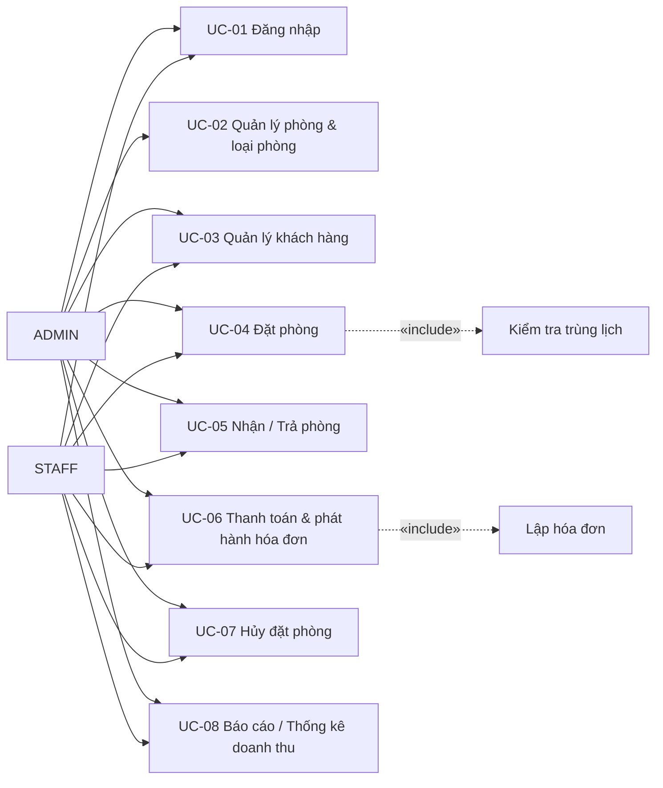

Ghi chú: UC-02 (quản lý phòng & loại phòng) là đặc quyền của ADMIN; «Kiểm tra trùng lịch» (include của UC-04) và «Lập hóa đơn» (include của UC-06) là các ca sử dụng «include».

## 1.8. Đặc tả các ca sử dụng cốt lõi

**UC-01 — Đăng nhập hệ thống (Login)**

| Mục | Nội dung |
|-----|----------|
| Tác nhân | ADMIN, STAFF |
| Mô tả | Xác thực người dùng bằng username/mật khẩu; mật khẩu so khớp với hash BCrypt; điều hướng giao diện theo vai trò |
| Tiền điều kiện | Ứng dụng đã khởi động; tài khoản tồn tại và đang hoạt động (`users.active = 1`) |
| Luồng chính | 1) Nhập username/mật khẩu (có thể bật "Hiển thị mật khẩu"). 2) `AuthService` tra tài khoản theo username. 3) `BCrypt.checkpw` so khớp hash. 4) Đúng → tạo `Session(id, username, fullName, role)` và mở màn hình chính. |
| Luồng phụ | 3a) Sai tài khoản/mật khẩu → "Sai tài khoản hoặc mật khẩu." |
| Hậu điều kiện | Người dùng vào màn hình chính với quyền ADMIN/STAFF |

**UC-02 — Quản lý Phòng & Loại phòng**

| Mục | Nội dung |
|-----|----------|
| Tác nhân | ADMIN |
| Mô tả | Xem danh sách phòng & loại phòng; thêm, sửa phòng; đổi trạng thái phòng (`AVAILABLE ↔ MAINTENANCE`; hệ thống còn quản lý `OCCUPIED`, `INACTIVE`); quản lý loại phòng (xem, thêm, sửa, cập nhật giá/đêm, ngưng/kích hoạt lại) |
| Tiền điều kiện | Đã đăng nhập với vai trò ADMIN |
| Luồng chính | 1) Mở tab "Phòng". 2) Hệ thống tải danh sách phòng và loại phòng. 3) ADMIN thêm/sửa phòng hoặc đổi trạng thái; thêm/sửa/cập nhật giá loại phòng. 4) `RoomService` kiểm tra hợp lệ rồi `RoomDAO` ghi xuống MySQL. |
| Luồng phụ | Thiếu số phòng → "Số phòng là bắt buộc."; tầng ≤ 0 → "Tầng phải lớn hơn 0."; giá ≤ 0 → "Giá mỗi đêm phải lớn hơn 0."; sức chứa ≤ 0 → "Sức chứa phải lớn hơn 0."; trùng số phòng → "Số phòng này đã tồn tại."; trùng tên loại → "Tên loại phòng này đã tồn tại."; trạng thái sai → "Trạng thái phòng không hợp lệ." |
| Hậu điều kiện | Danh mục phòng/loại phòng được cập nhật |

**UC-03 — Quản lý Khách hàng**

| Mục | Nội dung |
|-----|----------|
| Tác nhân | ADMIN, STAFF |
| Mô tả | Tìm kiếm/lọc, xem danh sách, thêm mới và cập nhật hồ sơ khách hàng (tên, SĐT, email, CMND/CCCD, địa chỉ); **chặn trùng số điện thoại** nhờ ràng buộc `UNIQUE (phone)` |
| Tiền điều kiện | Đã đăng nhập |
| Luồng chính | 1) Mở tab "Khách hàng". 2) Nhập thông tin và lưu. 3) `CustomerService` kiểm tra tên + SĐT. 4) `CustomerDAO` ghi vào bảng `customers`. |
| Luồng phụ | Thiếu tên/SĐT → "Tên và số điện thoại là bắt buộc."; trùng SĐT → "Số điện thoại này đã được dùng cho khách hàng khác." |
| Hậu điều kiện | Hồ sơ khách hàng được thêm/cập nhật |

**UC-04 — Đặt phòng (Booking / Reservation)**

| Mục | Nội dung |
|-----|----------|
| Tác nhân | ADMIN, STAFF |
| Mô tả | Lập phiếu đặt phòng cho một hoặc **nhiều phòng (đoàn khách)**, có thể áp **mã giảm giá**; dùng **Builder** (`BookingRequest.Builder`), **Facade** (`BookingFacade`) và chọn chính sách giá bằng **Strategy** (`PricingSelector`); tạo đơn trong **một transaction**, khóa phòng `FOR UPDATE` chống trùng lịch |
| Tiền điều kiện | Đã đăng nhập; tồn tại khách hàng và phòng ở trạng thái `AVAILABLE`/`OCCUPIED` |
| Luồng chính | 1) Chọn khách hàng, phòng, ngày nhận/trả (và mã giảm giá nếu có). 2) `Builder` kiểm tra: khách hàng bắt buộc, ≥ 1 phòng, `checkOut > checkIn`, ngày nhận không ở quá khứ. 3) Mở transaction, khóa phòng `FOR UPDATE`. 4) Kiểm tra trùng lịch với các đơn chưa `CANCELLED`/`CHECKED_OUT`. 5) Tạo `bookings` (`CONFIRMED`) + `booking_details`, tính `line_total` theo chính sách giá. 6) Commit và thông báo Observer. |
| Luồng phụ | 2a) Khoảng ngày sai → "Khoảng ngày không hợp lệ."; ngày quá khứ → "Ngày nhận phòng không được ở quá khứ."; chưa chọn phòng → "Cần chọn ít nhất một phòng." 4a) Trùng lịch → "Phòng #… đã được đặt trong khoảng thời gian này." (rollback) |
| Hậu điều kiện | Đơn `CONFIRMED` được tạo; phòng vẫn `AVAILABLE` cho tới khi nhận phòng |

**UC-05 — Vận hành Nhận / Trả phòng (Check-in / Check-out)**

| Mục | Nội dung |
|-----|----------|
| Tác nhân | ADMIN, STAFF |
| Mô tả | Nhận phòng đổi đơn `CONFIRMED → CHECKED_IN` và đồng bộ phòng `OCCUPIED`; trả phòng đổi `CHECKED_IN → CHECKED_OUT` và giải phóng phòng `AVAILABLE`; cập nhật trạng thái đơn và phòng trong cùng một transaction |

*Nhận phòng:*

| Mục | Nội dung |
|-----|----------|
| Tiền điều kiện | Đơn đang `CONFIRMED` |
| Luồng chính | 1) Chọn đơn. 2) `CONFIRMED → CHECKED_IN`. 3) Đồng bộ `rooms.status = OCCUPIED`. 4) Thông báo Observer. |
| Luồng phụ | Đơn không ở `CONFIRMED` → "Chỉ nhận phòng các đơn đã xác nhận." |
| Hậu điều kiện | Phòng hiển thị "Đang dùng" |

*Trả phòng:*

| Mục | Nội dung |
|-----|----------|
| Tiền điều kiện | Đơn đang `CHECKED_IN` |
| Luồng chính | 1) Chọn đơn. 2) `CHECKED_IN → CHECKED_OUT`. 3) Đồng bộ `rooms.status = AVAILABLE`. 4) Thông báo Observer. |
| Luồng phụ | Đơn chưa `CHECKED_IN` → "Chỉ trả phòng khi khách đã nhận phòng." |
| Hậu điều kiện | Phòng hiển thị "Trống" |

**UC-06 — Thanh toán & Phát hành hóa đơn**

| Mục | Nội dung |
|-----|----------|
| Tác nhân | ADMIN, STAFF |
| Mô tả | Thu tiền theo phương thức **tiền mặt / thẻ / chuyển khoản** (`PaymentFactory` tạo cổng thanh toán; chuyển khoản qua Adapter); hỗ trợ **thu nhiều lần**, hiển thị số tiền còn lại; **hóa đơn chỉ phát hành khi đã thu đủ** |
| Tiền điều kiện | Đơn tồn tại, chưa hủy, chưa thanh toán đủ |
| Luồng chính | 1) Chọn đơn, phương thức và số tiền thu. 2) Tính còn lại = tổng đơn − đã thu. 3) `PaymentFactory` tạo cổng thanh toán. 4) Ghi `payments`. 5) Nếu thu đủ → phát hành `invoices`. 6) Thông báo Observer. |
| Luồng phụ | Đơn đã hủy → "Không thể thanh toán đơn đã hủy."; đã thu đủ → "Đơn này đã thanh toán đủ."; số tiền ≤ 0 → "Số tiền thanh toán phải lớn hơn 0."; vượt số còn lại → "Số tiền vượt quá số còn lại (…)."; xem hóa đơn khi chưa có → "Đơn này chưa có hóa đơn. Hãy thanh toán trước." |
| Hậu điều kiện | Giao dịch được ghi nhận; nếu thu đủ thì có hóa đơn; doanh thu cập nhật |

**UC-07 — Hủy đặt phòng (Cancel Booking)**

| Mục | Nội dung |
|-----|----------|
| Tác nhân | ADMIN, STAFF |
| Mô tả | Hủy đơn ở trạng thái `PENDING`/`CONFIRMED`; **chặn** nếu đơn đã phát sinh thanh toán |
| Tiền điều kiện | Đơn ở `PENDING` hoặc `CONFIRMED` |
| Luồng chính | 1) Chọn đơn, xác nhận thao tác. 2) Kiểm tra đơn chưa có thanh toán. 3) Chuyển `→ CANCELLED`. 4) Thông báo Observer. |
| Luồng phụ | Đã có thanh toán → "Đơn đã có thanh toán. Vui lòng hoàn tiền trước khi hủy."; trạng thái không hợp lệ → "Không thể hủy đơn này." |
| Hậu điều kiện | Đơn ở trạng thái `CANCELLED` |

**UC-08 — Báo cáo / Thống kê doanh thu**

| Mục | Nội dung |
|-----|----------|
| Tác nhân | ADMIN, STAFF |
| Mô tả | Xem doanh thu theo ngày/tháng/loại phòng và công suất phòng; biểu đồ vẽ bằng Java2D (`BarChartPanel`); xem danh sách hóa đơn và tổng doanh thu đã thu |
| Tiền điều kiện | Đã đăng nhập |
| Luồng chính | 1) Mở tab "Báo cáo". 2) `ReportService` truy vấn doanh thu và công suất. 3) Vẽ biểu đồ, hiển thị tổng doanh thu và số đơn. 4) Đổi khoảng thời gian để xem lại. |
| Luồng phụ | Không có dữ liệu → biểu đồ rỗng, doanh thu = 0; khoảng ngày sai → "Ngày kết thúc phải sau ngày bắt đầu."; quá 120 ngày → "Khoảng báo cáo tối đa 120 ngày." |
| Hậu điều kiện | Người dùng nắm được tình hình doanh thu |

---

<a id="chương-2"></a>
# CHƯƠNG 2 — CƠ SỞ LÝ THUYẾT VÀ KIẾN TRÚC HỆ THỐNG

## 2.1. Cơ sở lý thuyết về Design Patterns

Design Patterns (mẫu thiết kế) là các giải pháp tổng quát, đã được kiểm chứng cho những vấn đề thiết kế phần mềm thường gặp. Theo phân loại kinh điển (GoF), có 3 nhóm chính:

### 2.1.1. Nhóm Creational (Khởi tạo)
Tập trung vào **cơ chế tạo đối tượng**, che giấu logic khởi tạo, tăng tính linh hoạt.
- **Singleton:** đảm bảo một lớp chỉ có một thể hiện duy nhất và cung cấp điểm truy cập toàn cục.
- **Factory Method:** định nghĩa interface tạo đối tượng, cho phép lớp con/quyết định runtime chọn lớp cụ thể.
- **Builder:** tách quá trình xây dựng đối tượng phức tạp khỏi biểu diễn của nó.
- (Khác: Abstract Factory, Prototype.)

### 2.1.2. Nhóm Structural (Cấu trúc)
Tập trung vào **cách tổ chức, ghép nối các lớp/đối tượng** để tạo cấu trúc lớn hơn.
- **Facade:** cung cấp giao diện đơn giản cho một tập hợp con hệ thống phức tạp.
- **Adapter:** chuyển đổi interface của lớp này thành interface mà client mong đợi.
- (Khác: Decorator, Composite, Proxy, Bridge, Flyweight.)

### 2.1.3. Nhóm Behavioral (Hành vi)
Tập trung vào **giao tiếp và phân chia trách nhiệm** giữa các đối tượng.
- **Strategy:** định nghĩa họ thuật toán, đóng gói từng thuật toán và cho phép hoán đổi tại runtime.
- **Observer:** thiết lập quan hệ phụ thuộc một–nhiều, khi một đối tượng đổi trạng thái thì các đối tượng phụ thuộc được thông báo tự động.
- (Khác: Command, State, Template Method, Iterator.)

**Bảng so sánh mục đích – trường hợp sử dụng:**

| Nhóm | Mục đích | Khi nào dùng |
|------|----------|--------------|
| Creational | Quản lý việc tạo đối tượng | Khi việc khởi tạo phức tạp hoặc cần kiểm soát số lượng/loại đối tượng |
| Structural | Tổ chức quan hệ giữa các lớp | Khi cần ghép nối hệ thống con, thích nghi interface, đơn giản hóa API |
| Behavioral | Phân chia hành vi/giao tiếp | Khi cần hoán đổi thuật toán, thông báo sự kiện, quản lý trạng thái |

## 2.2. Năm nguyên lý SOLID

| Nguyên lý | Nội dung | Ví dụ trong hệ thống |
|-----------|----------|----------------------|
| **SRP** – Đơn trách nhiệm | Một lớp chỉ nên có một lý do để thay đổi | `AuthService` chỉ xác thực, không chứa SQL; việc chọn giá tách khỏi DAO |
| **OCP** – Mở/Đóng | Mở để mở rộng, đóng để sửa đổi | Thêm phương thức thanh toán qua `PaymentFactory`; thêm chính sách giá qua `PricingStrategy` |
| **LSP** – Thay thế Liskov | Lớp con thay thế được lớp cha mà không phá vỡ chương trình | Mọi hiện thực `Payment`/`PricingStrategy`/`BookingObserver` dùng thay thế abstraction |
| **ISP** – Phân tách giao diện | Không ép client phụ thuộc phương thức không dùng | Các interface nhỏ: `Payment`, `BookingObserver`, `*Repository` |
| **DIP** – Đảo ngược phụ thuộc | Phụ thuộc abstraction, không phụ thuộc hiện thực | Service/Facade phụ thuộc `BookingRepository`, `PaymentRepository`… |

## 2.3. Thiết kế kiến trúc tổng thể phần mềm

Hệ thống áp dụng **mô hình 3 tầng (three-tier)** — tương ứng biến thể MVC cho ứng dụng desktop:

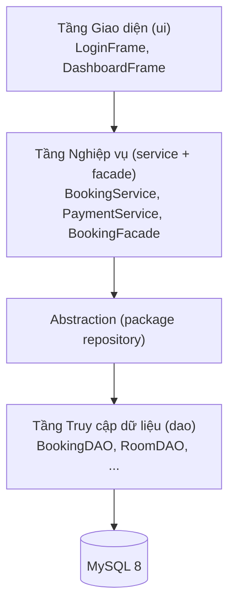

**Hình 2.1 — Kiến trúc 3 tầng**

Luồng phụ thuộc **một chiều** UI → Service/Facade → Repository (abstraction) → DAO → Database. Nhờ DIP, tầng nghiệp vụ chỉ biết tới interface `*Repository`, không biết lớp DAO cụ thể.

| Tầng | Gói | Trách nhiệm |
|------|-----|-------------|
| Giao diện (View) | `ui` | Hiển thị, thu nhận tương tác người dùng |
| Nghiệp vụ (Controller) | `service`, `patterns.facade` | Kiểm tra hợp lệ, điều phối nghiệp vụ |
| Trừu tượng dữ liệu (Abstraction) | `repository` | Hợp đồng interface `*Repository` — hiện thực hóa **DIP** |
| Truy cập dữ liệu (Model/Data) | `dao` | Truy vấn MySQL qua JDBC |
| Hạ tầng | `config` | Cấu hình kết nối (Singleton) |

## 2.4. Thiết kế mô hình thực thể dữ liệu

### 2.4.1. Tổng quan mô hình dữ liệu

Cơ sở dữ liệu `hotel_management` gồm **10 bảng**, được thiết kế theo hướng **chuẩn hóa (3NF)** và chia thành 4 nhóm chức năng:

| Nhóm | Bảng | Mục đích |
|------|------|----------|
| **Xác thực & nhân sự** | `roles`, `users`, `employees` | Phân quyền và tài khoản đăng nhập |
| **Danh mục phòng** | `room_types`, `rooms` | Loại phòng và phòng cụ thể |
| **Nghiệp vụ đặt phòng** | `customers`, `bookings`, `booking_details` | Khách hàng và chi tiết đặt phòng |
| **Tài chính** | `payments`, `invoices` | Thanh toán và hóa đơn |

Đặc điểm thiết kế:
- Mọi bảng dùng khóa chính `BIGINT AUTO_INCREMENT`.
- Dùng **`ENUM`** để giới hạn miền giá trị trạng thái (tránh dữ liệu rác).
- Dùng **`DECIMAL(12,2)`** cho mọi trường tiền tệ (tránh sai số làm tròn của số thực).
- Dùng **`TIMESTAMP DEFAULT CURRENT_TIMESTAMP`** để tự động ghi nhận thời điểm tạo.
- Ràng buộc **`FOREIGN KEY`** đảm bảo toàn vẹn tham chiếu; **`UNIQUE`** chống trùng; **`CHECK`** chặn giá trị vô lý.

### 2.4.2. Sơ đồ thực thể liên kết (ERD)

**Hình 2.2 — Sơ đồ thực thể liên kết (ERD):**

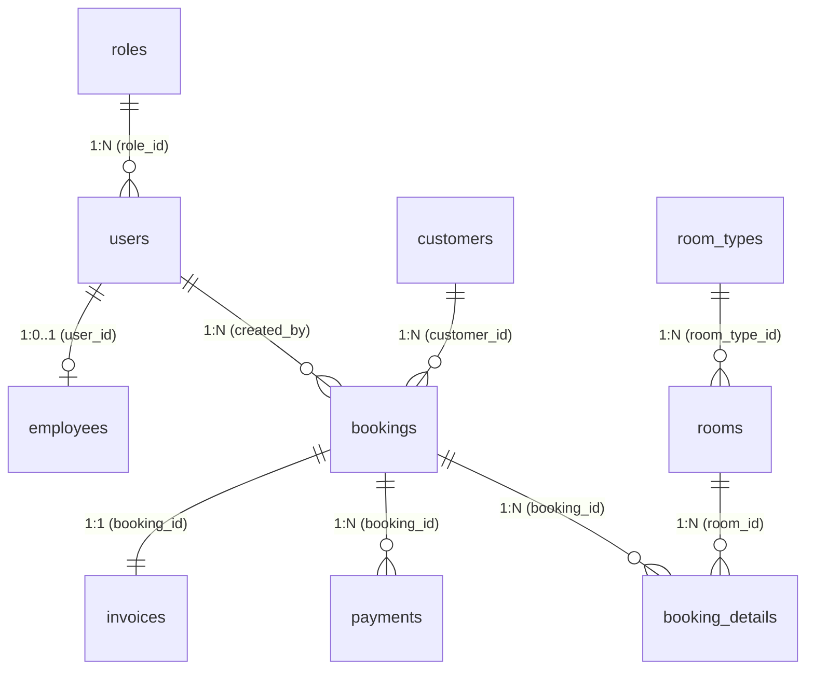

### 2.4.3. Chi tiết các bảng (từ điển dữ liệu)

> Quy ước: **PK** = khóa chính, **FK** = khóa ngoại, **U** = duy nhất (unique).

#### (1) Bảng `roles` — vai trò người dùng

| Cột | Kiểu | Ràng buộc | Mô tả |
|-----|------|-----------|-------|
| `id` | BIGINT | PK, AUTO_INCREMENT | Mã vai trò |
| `role_name` | VARCHAR(30) | NOT NULL, U | Tên vai trò (`ADMIN`, `STAFF`) |

#### (2) Bảng `users` — tài khoản đăng nhập

| Cột | Kiểu | Ràng buộc | Mô tả |
|-----|------|-----------|-------|
| `id` | BIGINT | PK, AUTO_INCREMENT | Mã tài khoản |
| `username` | VARCHAR(50) | NOT NULL, U | Tên đăng nhập |
| `password_hash` | VARCHAR(100) | NOT NULL | Mật khẩu đã băm **BCrypt** |
| `full_name` | VARCHAR(100) | NOT NULL | Họ tên người dùng |
| `role_id` | BIGINT | NOT NULL, FK → `roles(id)` | Vai trò |
| `active` | BOOLEAN | NOT NULL, DEFAULT TRUE | Trạng thái kích hoạt |
| `created_at` | TIMESTAMP | DEFAULT CURRENT_TIMESTAMP | Thời điểm tạo |

#### (3) Bảng `employees` — hồ sơ nhân viên

| Cột | Kiểu | Ràng buộc | Mô tả |
|-----|------|-----------|-------|
| `id` | BIGINT | PK, AUTO_INCREMENT | Mã nhân viên |
| `user_id` | BIGINT | NOT NULL, U, FK → `users(id)` | Liên kết tài khoản (1–1) |
| `phone` | VARCHAR(20) | — | Số điện thoại |
| `position_name` | VARCHAR(60) | — | Chức vụ |

#### (4) Bảng `customers` — khách hàng

| Cột | Kiểu | Ràng buộc | Mô tả |
|-----|------|-----------|-------|
| `id` | BIGINT | PK, AUTO_INCREMENT | Mã khách hàng |
| `full_name` | VARCHAR(100) | NOT NULL | Họ tên khách |
| `phone` | VARCHAR(20) | NOT NULL, **U** (`uk_customer_phone`) | Số điện thoại (định danh khách) |
| `email` | VARCHAR(100) | — | Email |
| `identity_number` | VARCHAR(30) | — | Số CCCD/CMND |
| `address` | VARCHAR(255) | — | Địa chỉ |
| `created_at` | TIMESTAMP | DEFAULT CURRENT_TIMESTAMP | Thời điểm tạo |

#### (5) Bảng `room_types` — loại phòng

| Cột | Kiểu | Ràng buộc | Mô tả |
|-----|------|-----------|-------|
| `id` | BIGINT | PK, AUTO_INCREMENT | Mã loại phòng |
| `type_name` | VARCHAR(60) | NOT NULL, U | Tên loại (Standard/Deluxe/Suite) |
| `description` | VARCHAR(255) | — | Mô tả |
| `price_per_night` | DECIMAL(12,2) | NOT NULL, CHECK ≥ 0 | Giá/đêm |
| `capacity` | INT | NOT NULL, DEFAULT 2, CHECK > 0 | Sức chứa |
| `active` | BOOLEAN | NOT NULL, DEFAULT TRUE | Còn kinh doanh hay không |

#### (6) Bảng `rooms` — phòng

| Cột | Kiểu | Ràng buộc | Mô tả |
|-----|------|-----------|-------|
| `id` | BIGINT | PK, AUTO_INCREMENT | Mã phòng |
| `room_number` | VARCHAR(20) | NOT NULL, **U** | Số phòng |
| `room_type_id` | BIGINT | NOT NULL, FK → `room_types(id)` | Loại phòng |
| `floor_number` | INT | NOT NULL, DEFAULT 1 | Tầng |
| `status` | ENUM | NOT NULL, DEFAULT 'AVAILABLE' | `AVAILABLE` / `OCCUPIED` / `MAINTENANCE` / `INACTIVE` |
| `note` | VARCHAR(255) | — | Ghi chú |

> **Điểm nhấn:** giá trị `OCCUPIED` trong `status` phục vụ **đồng bộ trạng thái phòng** khi khách nhận/trả phòng (Chương 3, Mục 3.2.1 và Chương 4).

#### (7) Bảng `bookings` — đơn đặt phòng

| Cột | Kiểu | Ràng buộc | Mô tả |
|-----|------|-----------|-------|
| `id` | BIGINT | PK, AUTO_INCREMENT | Mã đơn |
| `booking_code` | VARCHAR(30) | NOT NULL, U | Mã đơn (hiển thị) |
| `customer_id` | BIGINT | NOT NULL, FK → `customers(id)` | Khách đặt |
| `created_by` | BIGINT | FK → `users(id)` | Người tạo đơn |
| `check_in` | DATE | NOT NULL | Ngày nhận phòng |
| `check_out` | DATE | NOT NULL | Ngày trả phòng |
| `status` | ENUM | NOT NULL, DEFAULT 'CONFIRMED' | `PENDING` / `CONFIRMED` / `CHECKED_IN` / `CHECKED_OUT` / `CANCELLED` |
| `note` | VARCHAR(500) | — | Ghi chú |
| `created_at` | TIMESTAMP | DEFAULT CURRENT_TIMESTAMP | Thời điểm tạo |
| — | — | **CHECK** (`check_out` > `check_in`) | Chặn khoảng ngày vô lý |

#### (8) Bảng `booking_details` — chi tiết đặt phòng

| Cột | Kiểu | Ràng buộc | Mô tả |
|-----|------|-----------|-------|
| `id` | BIGINT | PK, AUTO_INCREMENT | Mã chi tiết |
| `booking_id` | BIGINT | NOT NULL, FK → `bookings(id)` | Đơn đặt phòng |
| `room_id` | BIGINT | NOT NULL, FK → `rooms(id)` | Phòng được đặt |
| `price_per_night` | DECIMAL(12,2) | NOT NULL | Giá/đêm tại thời điểm đặt |
| `nights` | INT | NOT NULL, CHECK > 0 | Số đêm |
| `line_total` | DECIMAL(12,2) | NOT NULL, CHECK ≥ 0 | Thành tiền |
| — | — | **U** (`booking_id`, `room_id`) | Một phòng không lặp trong cùng đơn |

#### (9) Bảng `payments` — thanh toán

| Cột | Kiểu | Ràng buộc | Mô tả |
|-----|------|-----------|-------|
| `id` | BIGINT | PK, AUTO_INCREMENT | Mã thanh toán |
| `booking_id` | BIGINT | NOT NULL, FK → `bookings(id)` | Đơn được thanh toán |
| `amount` | DECIMAL(12,2) | NOT NULL, CHECK > 0 | Số tiền |
| `method` | ENUM | NOT NULL | `CASH` / `CARD` / `BANK_TRANSFER` |
| `status` | ENUM | NOT NULL, DEFAULT 'PAID' | `PENDING` / `PAID` / `REFUNDED` |
| `paid_at` | TIMESTAMP | DEFAULT CURRENT_TIMESTAMP | Thời điểm thanh toán |

> Một đơn có thể có **nhiều** bản ghi thanh toán (trả nhiều lần) → quan hệ **1:N**.

#### (10) Bảng `invoices` — hóa đơn

| Cột | Kiểu | Ràng buộc | Mô tả |
|-----|------|-----------|-------|
| `id` | BIGINT | PK, AUTO_INCREMENT | Mã hóa đơn |
| `invoice_code` | VARCHAR(30) | NOT NULL, U | Mã hóa đơn |
| `booking_id` | BIGINT | NOT NULL, **U**, FK → `bookings(id)` | Đơn tương ứng (1–1) |
| `total_amount` | DECIMAL(12,2) | NOT NULL | Tổng tiền |
| `issued_at` | TIMESTAMP | DEFAULT CURRENT_TIMESTAMP | Thời điểm phát hành |

> Ràng buộc `UNIQUE(booking_id)` đảm bảo mỗi đơn chỉ có **tối đa một** hóa đơn → quan hệ **1:1**.

### 2.4.4. Quan hệ giữa các bảng

| Quan hệ | Kiểu | Khóa ngoại | Ý nghĩa |
|---------|------|-----------|---------|
| `roles` → `users` | 1:N | `users.role_id` | Một vai trò gán cho nhiều tài khoản |
| `users` → `employees` | 1:0..1 | `employees.user_id` (U) | Một tài khoản có thể là nhân viên |
| `users` → `bookings` | 1:N | `bookings.created_by` | Một nhân viên tạo nhiều đơn |
| `customers` → `bookings` | 1:N | `bookings.customer_id` | Một khách đặt nhiều đơn |
| `room_types` → `rooms` | 1:N | `rooms.room_type_id` | Một loại có nhiều phòng |
| `bookings` → `booking_details` | 1:N | `booking_details.booking_id` | Một đơn gồm nhiều dòng chi tiết |
| `rooms` → `booking_details` | 1:N | `booking_details.room_id` | Một phòng xuất hiện trong nhiều đơn (khác thời gian) |
| `bookings` → `payments` | 1:N | `payments.booking_id` | Một đơn có nhiều lần thanh toán |
| `bookings` → `invoices` | 1:1 | `invoices.booking_id` (U) | Một đơn có một hóa đơn |

### 2.4.5. Ràng buộc toàn vẹn và quy tắc nghiệp vụ ở mức CSDL

| Loại ràng buộc | Tên | Ý nghĩa nghiệp vụ |
|----------------|-----|-------------------|
| UNIQUE | `uk_customer_phone` | Mỗi số điện thoại ứng với một khách (chống tạo trùng) |
| UNIQUE | `rooms.room_number` | Số phòng không trùng |
| UNIQUE | `bookings.booking_code`, `invoices.invoice_code` | Mã đơn/hóa đơn không trùng |
| UNIQUE | `uk_booking_room (booking_id, room_id)` | Cùng một phòng không lặp trong một đơn |
| CHECK | `bookings`: `check_out > check_in` | Ngày trả phải sau ngày nhận |
| CHECK | `booking_details`: `nights > 0`, `line_total >= 0` | Số đêm và thành tiền hợp lệ |
| CHECK | `room_types`: `price_per_night >= 0`, `capacity > 0` | Giá và sức chứa hợp lệ |
| CHECK | `payments`: `amount > 0` | Số tiền thanh toán dương |
| FK | `fk_*` | Chặn xóa/tham chiếu tới bản ghi không tồn tại |
| ENUM | `rooms.status`, `bookings.status`, `payments.method`, `payments.status` | Giới hạn miền trạng thái/phương thức hợp lệ |

Các ràng buộc này được **đối ứng ở tầng ứng dụng**: `SqlErrors` chuyển mã lỗi `1062` (trùng UNIQUE), `1451/1452` (vi phạm khóa ngoại), `SQLState 23xxx` (vi phạm CHECK) thành thông báo tiếng Việt thân thiện (xem Mục 4.6).

### 2.4.6. Ánh xạ bảng ↔ lớp mô hình ↔ lớp truy cập

| Bảng CSDL | Lớp mô hình (`model`) | Lớp truy cập (`dao`) |
|-----------|-----------------------|----------------------|
| `bookings`, `booking_details` | `Booking` | `BookingDAO` / `BookingRepository` |
| `customers` | `Customer` | `CustomerDAO` / `CustomerRepository` |
| `rooms` | `Room` | `RoomDAO` / `RoomRepository` |
| `room_types` | `RoomType` | `RoomDAO` / `RoomRepository` |
| `payments` | — (chỉ tổng hợp số tiền) | `PaymentDAO` / `PaymentRepository` |
| `invoices` | `Invoice` | `InvoiceDAO` / `InvoiceRepository` |
| `users`, `roles` | — (`Account` là record nội bộ) | `UserDAO` / `UserRepository` |

> **Nhận xét:** mô hình dữ liệu tách bạch danh mục (phòng, loại phòng, khách) khỏi giao dịch (đặt phòng, thanh toán, hóa đơn), đảm bảo chuẩn hóa và phản ánh đúng quy trình nghiệp vụ ở Chương 1. Việc bổ sung `OCCUPIED` vào `rooms.status` là thay đổi trực tiếp trong script `database/hotel_management.sql` để hỗ trợ đồng bộ trạng thái phòng.

---

<a id="chương-3"></a>
# CHƯƠNG 3 — PHÂN TÍCH VÀ THIẾT KẾ CHI TIẾT CÁC MẪU THIẾT KẾ ÁP DỤNG

> Mỗi mục dưới đây trình bày theo khung: (1) Mục đích & lý do chọn; (2) Class Diagram; (3) Sequence Diagram **kèm bảng vai trò các lớp**; (4) Ánh xạ mã nguồn; (5) So sánh ưu/nhược với thiết kế thông thường; (6) Đánh giá tuân thủ SOLID.

## 3.1. Nhóm Creational

### 3.1.1. Singleton — `DatabaseConnection`

**(1) Mục đích:** đảm bảo toàn ứng dụng dùng chung một điểm quản lý cấu hình/kết nối CSDL, tránh tạo nhiều thể hiện cấu hình trùng lặp.

**(2) Class Diagram (Hình 3.1):**

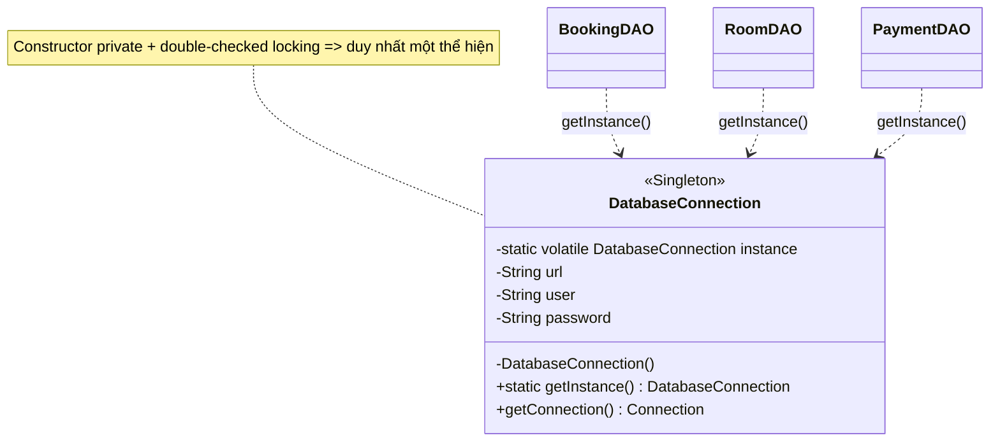

**(3) Sequence Diagram (Hình 3.2) & vai trò các lớp:**

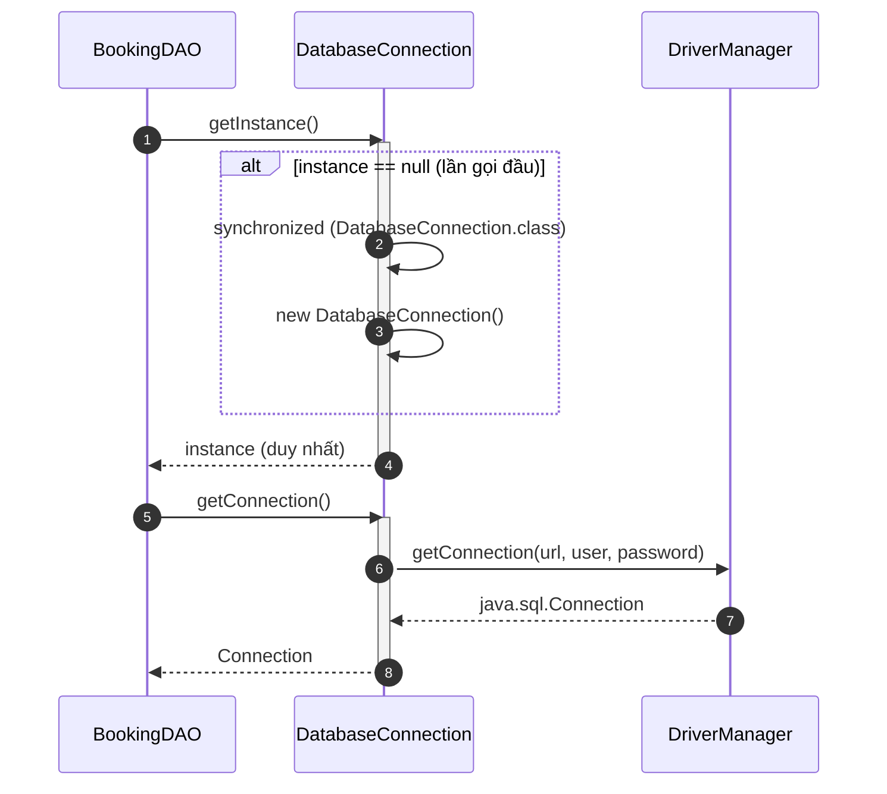

| Lớp | Vai trò (GoF) | Trách nhiệm trong hệ thống |
|-----|---------------|----------------------------|
| `DatabaseConnection` | **Singleton** | Giữ thể hiện duy nhất; nạp driver MySQL; cấp `Connection` theo cấu hình `DB_URL/DB_USER/DB_PASSWORD`. |
| `BookingDAO`, `RoomDAO`, `PaymentDAO`, … | **Client** | Gọi `getInstance().getConnection()`; không tự đọc cấu hình hay mở kết nối riêng. |
| `DriverManager` / `com.mysql.cj.jdbc.Driver` | **Collaborator** | Mở kết nối vật lý tới MySQL 8. |

> **Quan hệ:** Client **phụ thuộc (dependency)** vào Singleton qua điểm truy cập tĩnh `getInstance()`; Singleton **không** bị kế thừa hay bao chứa (constructor `private`), nên chỉ có một đường vào duy nhất.

**(4) Ánh xạ mã nguồn:**

```java
public final class DatabaseConnection {
    private static volatile DatabaseConnection instance;
    private DatabaseConnection() { /* nạp driver */ }
    public static DatabaseConnection getInstance() {
        if (instance == null) {
            synchronized (DatabaseConnection.class) {
                if (instance == null) instance = new DatabaseConnection();
            }
        }
        return instance;
    }
    public Connection getConnection() throws SQLException {
        return DriverManager.getConnection(url, user, password);
    }
}
```

**(5) Ưu/nhược so với thiết kế thông thường:** thay vì mỗi DAO tự đọc cấu hình và tạo `Connection`, Singleton tập trung cấu hình một chỗ, dễ đổi môi trường (qua biến `DB_URL/DB_USER/DB_PASSWORD`). Nhược điểm: là trạng thái toàn cục, cần cẩn trọng khi kiểm thử song song (đã xử lý bằng `volatile` + double-checked locking).

**(6) SOLID:** chủ yếu hỗ trợ **SRP** (tách nhiệm vụ cấu hình kết nối khỏi DAO) và tạo nền tảng cho **DIP** ở các tầng trên.

### 3.1.2. Factory Method — `PaymentFactory`

**(1) Mục đích:** tạo đối tượng thanh toán theo phương thức người dùng chọn mà **client không cần biết lớp cụ thể**.

**(2) Class Diagram (Hình 3.3):**

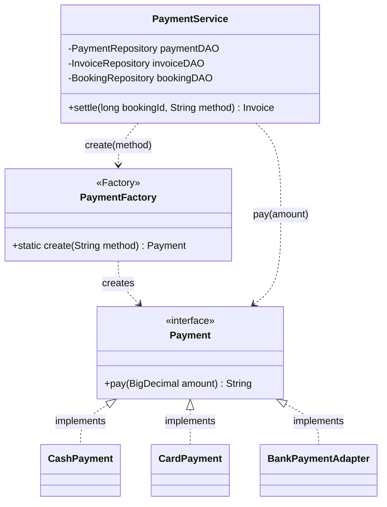

**(3) Sequence Diagram (Hình 3.4) & vai trò các lớp:**

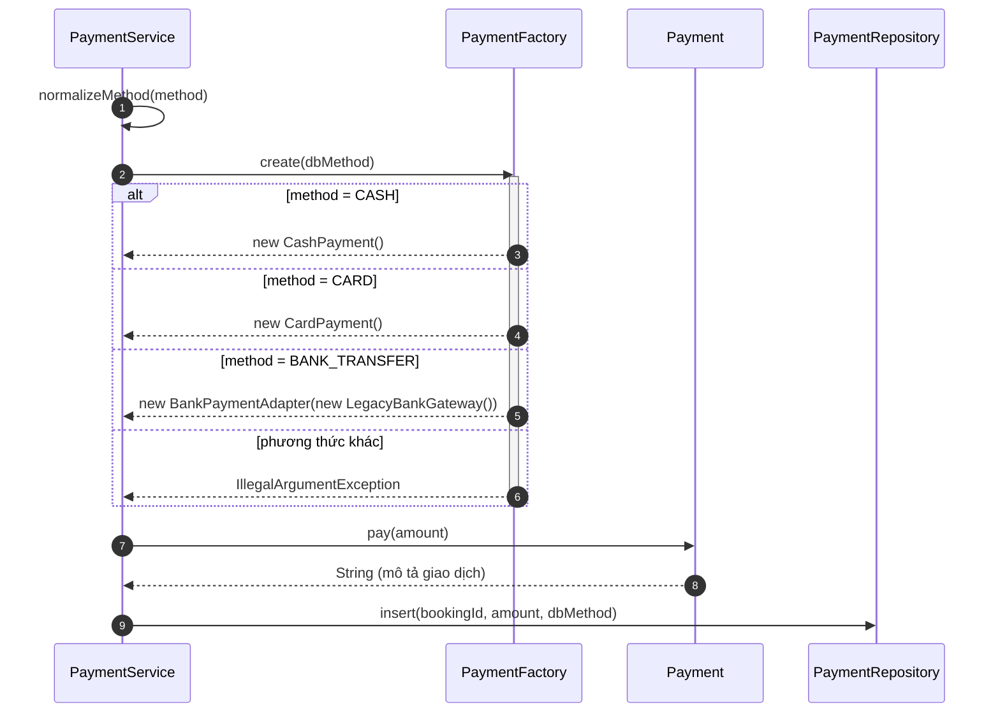

| Lớp | Vai trò (GoF) | Trách nhiệm trong hệ thống |
|-----|---------------|----------------------------|
| `Payment` | **Product** | Hợp đồng chung `pay(BigDecimal): String` cho mọi phương thức thanh toán. |
| `CashPayment`, `CardPayment` | **ConcreteProduct** | Hiện thực thanh toán tiền mặt / thẻ. |
| `BankPaymentAdapter` | **ConcreteProduct** (đồng thời là Adapter) | Bọc cổng ngân hàng cũ, vẫn thoả hợp đồng `Payment`. |
| `PaymentFactory` | **Factory** | Chọn và khởi tạo lớp cụ thể theo `method`; là điểm duy nhất biết các lớp cụ thể. |
| `PaymentService` | **Client** | Chỉ biết kiểu trừu tượng `Payment` và `PaymentFactory`, không `new` lớp cụ thể. |

> **Quan hệ:** `Payment` là **interface**, ba lớp kia **hiện thực (realization)**; `PaymentFactory` **phụ thuộc** `Payment` để trả về; Client **phụ thuộc** cả Factory lẫn Product.

**(4) Ánh xạ mã nguồn:**

```java
public static Payment create(String method) {
    return switch (method.toUpperCase()) {
        case "CASH" -> new CashPayment();
        case "CARD" -> new CardPayment();
        case "BANK", "BANK_TRANSFER" -> new BankPaymentAdapter(new LegacyBankGateway());
        default -> throw new IllegalArgumentException("Phương thức thanh toán không hỗ trợ: " + method);
    };
}
```

**(5) Ưu/nhược:** thay vì dùng `if/else` rải rác khắp nơi để tạo đối tượng thanh toán, Factory tập trung một điểm. **Nhược:** khi thêm phương thức mới vẫn phải sửa factory (đánh đổi chấp nhận được; có thể chuyển sang registry nếu cần).

**(6) SOLID:** minh họa **OCP** — thêm phương thức thanh toán mới chủ yếu mở rộng (thêm lớp `Payment`), đồng thời hỗ trợ **DIP** vì client phụ thuộc interface `Payment`.

### 3.1.3. Builder — `BookingRequest.Builder`

**(1) Mục đích:** dựng đối tượng yêu cầu đặt phòng gồm nhiều tham số, đồng thời **kiểm tra tính hợp lệ tập trung** trước khi khởi tạo.

**(2) Class Diagram (Hình 3.5):**

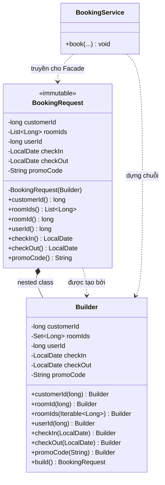

**(3) Sequence Diagram (Hình 3.6) & vai trò các lớp:**

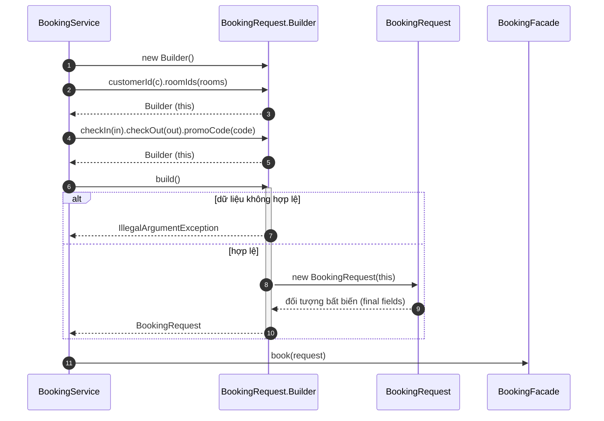

| Lớp | Vai trò (GoF) | Trách nhiệm trong hệ thống |
|-----|---------------|----------------------------|
| `BookingRequest` | **Product** (bất biến) | Lưu yêu cầu đặt phòng đã kiểm tra hợp lệ; constructor `private`, không có setter. |
| `BookingRequest.Builder` | **Builder** | Gom tham số theo từng bước (fluent API), kiểm tra hợp lệ tập trung trong `build()`. |
| `BookingService` | **Director / Client** | Điều khiển thứ tự gọi các bước rồi lấy `BookingRequest`. |
| `BookingFacade` | **Client tiêu thụ** | Nhận `BookingRequest` bất biến để chọn giá và lưu đơn. |

> **Quan hệ:** `Builder` là **lớp lồng (nested)** trong `BookingRequest` (quan hệ composition `*--`); `BookingService` **phụ thuộc** Builder để dựng và `BookingRequest` để truyền đi.

**(4) Ánh xạ mã nguồn:**

```java
public BookingRequest build() {
    if (customerId <= 0 || roomId <= 0)
        throw new IllegalArgumentException("Khách hàng và phòng là bắt buộc.");
    if (checkIn == null || checkOut == null || !checkOut.isAfter(checkIn))
        throw new IllegalArgumentException("Khoảng ngày không hợp lệ.");
    if (checkIn.isBefore(LocalDate.now()))
        throw new IllegalArgumentException("Ngày nhận phòng không được ở quá khứ.");
    return new BookingRequest(this);
}
```

**(5) Ưu/nhược:** tránh constructor "telescoping" (quá nhiều tham số), đảm bảo đối tượng luôn hợp lệ. Nhược: thêm lớp `Builder` (mã nguồn dài hơn) — nhưng bù lại tính rõ ràng, an toàn.

**(6) SOLID:** minh họa **SRP** (logic xây dựng/kiểm tra tách khỏi nghiệp vụ) và bảo toàn bất biến của đối tượng.

## 3.2. Nhóm Structural

### 3.2.1. Facade — `BookingFacade`

**(1) Mục đích:** cung cấp **một giao diện thống nhất** cho chuỗi nghiệp vụ đặt/check-in/check-out/hủy/thanh toán, che giấu sự phối hợp phức tạp giữa DAO, dịch vụ thanh toán và thông báo.

**(2) Class Diagram (Hình 3.7):**

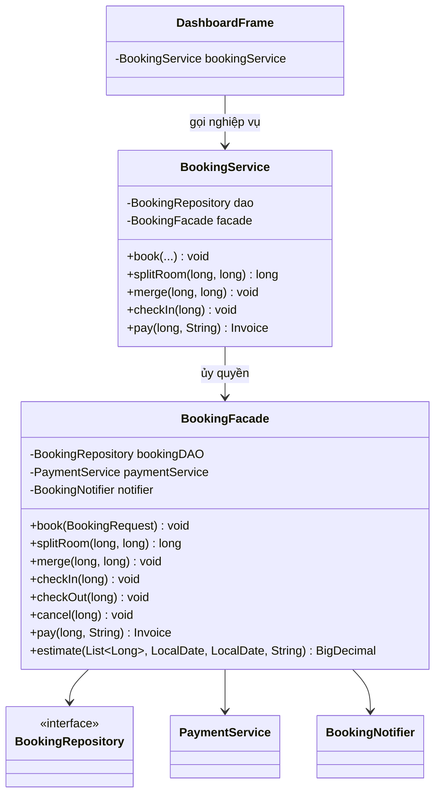

**(3) Sequence Diagram (Hình 3.8) — luồng đặt phòng nhiều phòng & vai trò các lớp:**

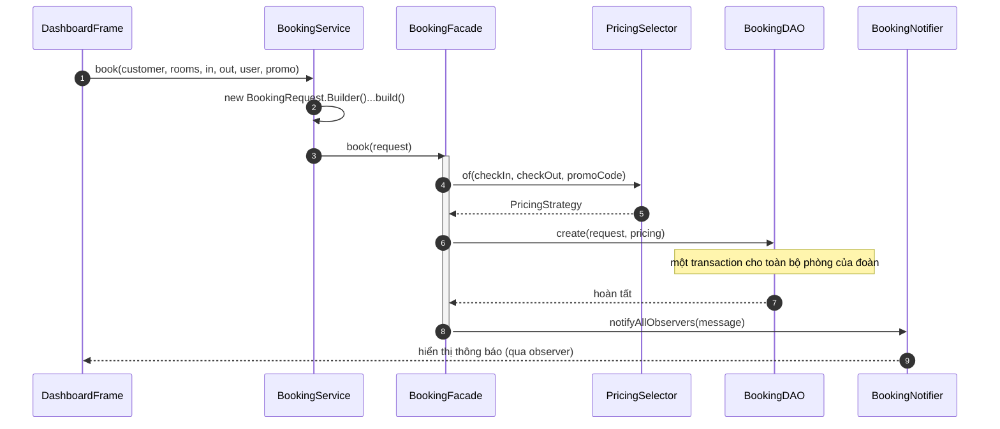

| Lớp | Vai trò (GoF) | Trách nhiệm trong hệ thống |
|-----|---------------|----------------------------|
| `BookingFacade` | **Facade** | Một cửa vào thống nhất cho chuỗi nghiệp vụ đặt/check-in/check-out/hủy/thanh toán/tách-ghép đơn. |
| `BookingService` | **Client (tầng trên)** | Gọi Facade; UI không phải tự phối hợp nhiều lớp. |
| `BookingRepository` | **Subsystem** | Truy vấn/ghi dữ liệu đặt phòng (abstraction — DIP). |
| `PaymentService` | **Subsystem** | Xử lý thanh toán, hoàn tiền, hóa đơn. |
| `BookingNotifier` | **Subsystem** | Phát sự kiện thông báo sau mỗi thao tác. |

> **Quan hệ:** `BookingService` **kết hợp (association)** `BookingFacade`; Facade **kết hợp** ba subsystem con qua **interface/abstraction**, che giấu hoàn toàn sự phối hợp phức tạp bên trong.

**(4) Ánh xạ mã nguồn:**

```java
public void book(BookingRequest request) throws SQLException {
    PricingStrategy pricing = PricingSelector.of(request.checkIn(), request.checkOut());
    bookingDAO.create(request, pricing);
    notifier.notifyAllObservers("Đã tạo đặt phòng cho khách #" + request.customerId()
            + ". Áp dụng " + pricing.name() + ".");
}

public void cancel(long bookingId) throws SQLException {
    if (paymentService.hasPayments(bookingId))
        throw new IllegalStateException("Đơn đã có thanh toán. Vui lòng hoàn tiền trước khi hủy.");
    bookingDAO.cancel(bookingId);
    notifier.notifyAllObservers("Đã hủy đặt phòng #" + bookingId + ".");
}
```

**(5) Ưu/nhược:** UI gọi một phương thức duy nhất thay vì tự phối hợp nhiều lớp. Nhược: Facade có thể "phình to" nếu gom quá nhiều nghiệp vụ — cần giữ phạm vi hợp lý.

**(6) SOLID:** rõ nét **SRP** (tầng giao diện không phải điều phối nghiệp vụ) và giúp **DIP** được thể hiện tập trung.

### 3.2.2. Adapter — `BankPaymentAdapter`

**(1) Mục đích:** tái sử dụng **cổng ngân hàng cũ `LegacyBankGateway`** (API khác) mà không sửa lớp cũ, bằng cách bọc nó về interface `Payment` chung.

**(2) Class Diagram (Hình 3.9):**

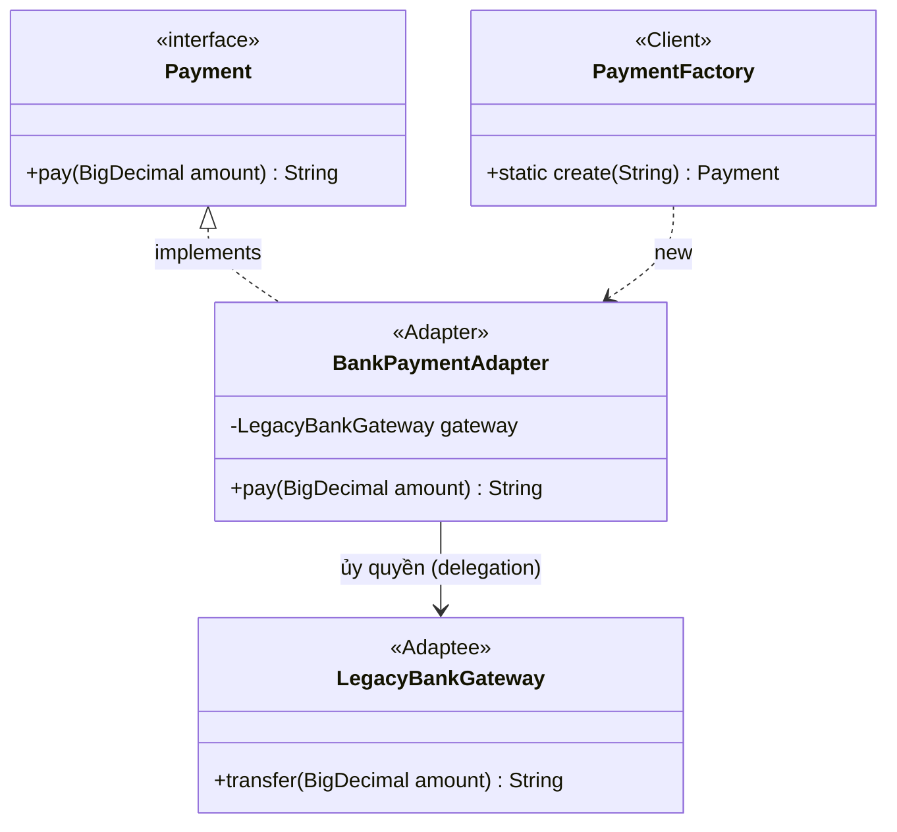

**(3) Sequence Diagram (Hình 3.10) & vai trò các lớp:**

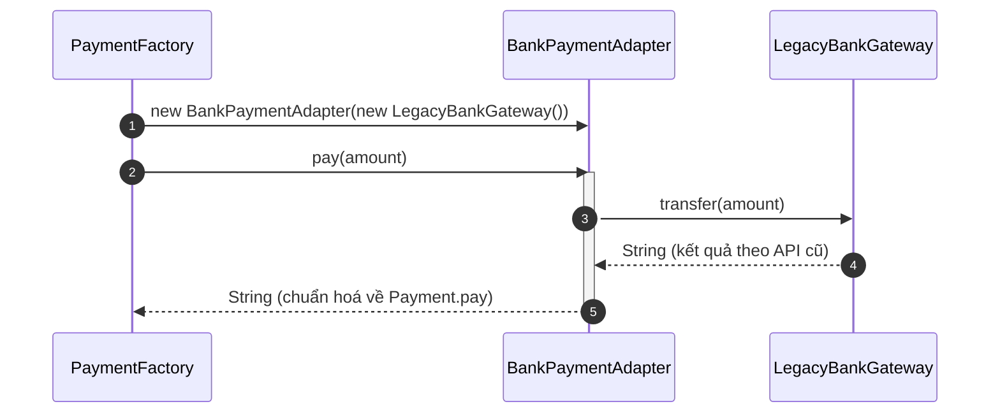

| Lớp | Vai trò (GoF) | Trách nhiệm trong hệ thống |
|-----|---------------|----------------------------|
| `Payment` | **Target** | Interface mà hệ thống mới mong đợi (`pay`). |
| `BankPaymentAdapter` | **Adapter** | Chuyển lời gọi `pay(amount)` thành `gateway.transfer(amount)`. |
| `LegacyBankGateway` | **Adaptee** | Cổng ngân hàng cũ với API `transfer(...)` khác tên/ngữ nghĩa. |
| `PaymentFactory` | **Client** | Tạo Adapter khi người dùng chọn chuyển khoản. |

> **Quan hệ:** `BankPaymentAdapter` **hiện thực (realization)** `Payment` và **kết hợp (association)** `LegacyBankGateway` (ủy quyền) — lớp cũ **không bị sửa đổi**.

**(4) Ánh xạ mã nguồn:**

```java
public class BankPaymentAdapter implements Payment {
    private final LegacyBankGateway gateway;
    public BankPaymentAdapter(LegacyBankGateway gateway) { this.gateway = gateway; }
    public String pay(BigDecimal amount) { return gateway.transfer(amount); }
}
```

**(5) Ưu/nhược:** Không cần sửa `LegacyBankGateway`; hệ thống đồng nhất qua `Payment`. Nhược: thêm một lớp trung gian.

**(6) SOLID:** minh họa **OCP** (mở rộng không sửa lớp cũ), **LSP** (Adapter thay thế được `Payment`) và **DIP**.

### 3.2.3. Decorator — `PromoPricing`

**(1) Mục đích:** **bọc thêm** hành vi giảm giá khuyến mãi lên một `PricingStrategy` đã có mà **không sửa** lớp tính giá gốc, cho phép ghép nhiều quy tắc (mùa/cuối tuần + mã giảm giá) một cách linh hoạt.

**(2) Class Diagram (Hình 3.11):**

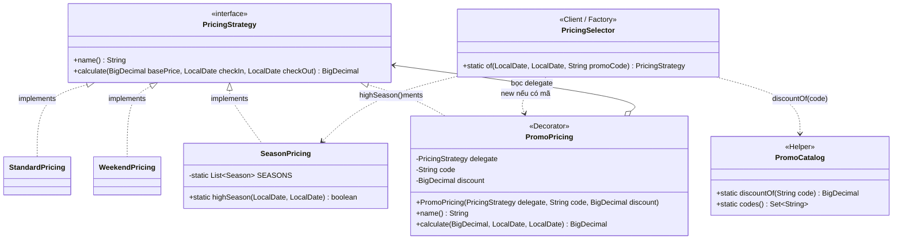

**(3) Sequence Diagram (Hình 3.12) & vai trò các lớp:**

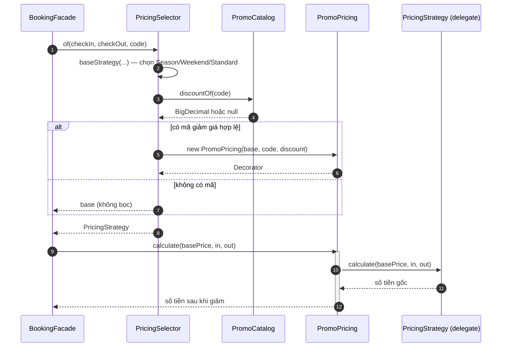

| Lớp | Vai trò (GoF) | Trách nhiệm trong hệ thống |
|-----|---------------|----------------------------|
| `PricingStrategy` | **Component** | Hợp đồng chung `name()` + `calculate(...)`. |
| `StandardPricing`, `WeekendPricing`, `SeasonPricing` | **ConcreteComponent** | Các chính sách giá cơ sở (tiêu chuẩn / cuối tuần / cao điểm mùa). |
| `PromoPricing` | **Decorator** (vừa là ConcreteDecorator) | Giữ tham chiếu `delegate`, gọi tính giá gốc rồi nhân hệ số `(1 - discount)`. |
| `PromoCatalog` | **Helper** | Tra mã khuyến mãi → tỉ lệ giảm (`WELCOME5`, `SUMMER10`, `GROUP15`). |
| `PricingSelector` | **Client** | Chọn lớp cơ sở và quyết định có bọc Decorator hay không. |

> **Quan hệ:** `PromoPricing` **hiện thực** `PricingStrategy` **và** **kết hợp (aggregation `o-->`)** một `PricingStrategy` khác làm `delegate` — đây là đặc trưng "tự bọc" của Decorator, cho phép xếp chồng nhiều decorator mà không phá vỡ kiểu gốc (LSP).

**(4) Ánh xạ mã nguồn:**

```java
public class PromoPricing implements PricingStrategy {
    private final PricingStrategy delegate;
    private final String code;
    private final BigDecimal discount;

    public PromoPricing(PricingStrategy delegate, String code, BigDecimal discount) {
        if (discount == null || discount.compareTo(BigDecimal.ZERO) < 0
                || discount.compareTo(BigDecimal.ONE) >= 0) {
            throw new IllegalArgumentException("Tỉ lệ giảm giá không hợp lệ.");
        }
        this.delegate = delegate;
        this.code = code == null ? "" : code.trim().toUpperCase();
        this.discount = discount;
    }

    @Override
    public String name() {
        return delegate.name() + " + KM " + code + " (-" + ... + "%)";
    }

    @Override
    public BigDecimal calculate(BigDecimal basePrice, LocalDate checkIn, LocalDate checkOut) {
        BigDecimal amount = delegate.calculate(basePrice, checkIn, checkOut);   // gọi lớp gốc
        return amount.multiply(BigDecimal.ONE.subtract(discount)).setScale(2, RoundingMode.HALF_UP);
    }
}
```

**(5) Ưu/nhược:** thêm khuyến mãi mới chỉ cần thêm mã trong `PromoCatalog` hoặc tạo decorator mới — **không sửa** các lớp `*Pricing` gốc. Nhược: nếu lạm dụng nhiều tầng decorator sẽ khó lần theo thứ tự tính toán; cần giữ chuỗi bọc ngắn, rõ ràng.

**(6) SOLID:** minh họa **OCP** (mở rộng hành vi mà không sửa lớp gốc), **LSP** (`PromoPricing` thay thế được `PricingStrategy`), **DIP** (phụ thuộc interface `PricingStrategy`) và **SRP** (mỗi decorator một quy tắc).

## 3.3. Nhóm Behavioral

### 3.3.1. Strategy — `PricingStrategy`

**(1) Mục đích:** đóng gói các **chính sách tính giá** và hoán đổi tại runtime (giá tiêu chuẩn vs. giá cuối tuần +10%).

**(2) Class Diagram (Hình 3.13):**

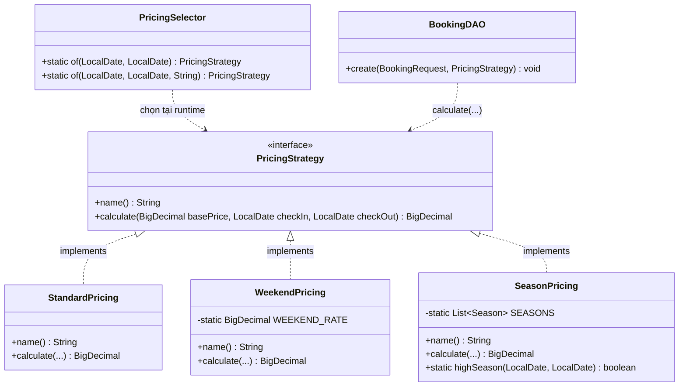

**(3) Sequence Diagram (Hình 3.14) & vai trò các lớp:**

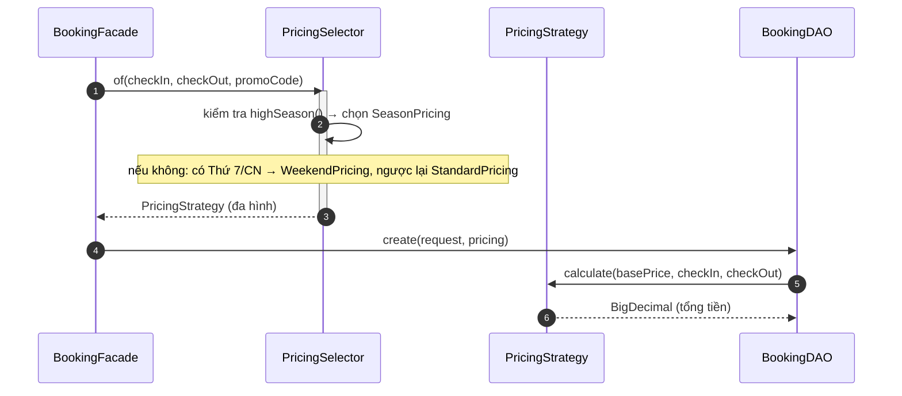

| Lớp | Vai trò (GoF) | Trách nhiệm trong hệ thống |
|-----|---------------|----------------------------|
| `PricingStrategy` | **Strategy** | Khai báo hợp đồng chung `name()` và `calculate(base, in, out)`. |
| `StandardPricing` | **ConcreteStrategy** | Giá = giá phòng × số đêm. |
| `WeekendPricing` | **ConcreteStrategy** | Cộng thêm 10% cho các đêm Thứ 7/Chủ nhật. |
| `SeasonPricing` | **ConcreteStrategy** | Áp hệ số cao điểm theo mùa (Tết, 30/4–1/5, Hè). |
| `PricingSelector` | **Context / Factory** | Chọn concrete strategy phù hợp theo khoảng ngày (và mã khuyến mãi). |
| `BookingDAO` | **Client** | Nhận `PricingStrategy` và gọi `calculate(...)` mà không biết lớp cụ thể. |

> **Quan hệ:** ba `ConcreteStrategy` **hiện thực (realization)** `PricingStrategy`; `PricingSelector` và `BookingDAO` chỉ **phụ thuộc** vào interface — hoán đổi thuật toán tại runtime mà không sửa mã gọi.

**(4) Ánh xạ mã nguồn:**

```java
public final class PricingSelector {
    public static PricingStrategy of(LocalDate checkIn, LocalDate checkOut) {
        for (LocalDate day = checkIn; day.isBefore(checkOut); day = day.plusDays(1)) {
            DayOfWeek w = day.getDayOfWeek();
            if (w == DayOfWeek.SATURDAY || w == DayOfWeek.SUNDAY) return new WeekendPricing();
        }
        return new StandardPricing();
    }
}
```

```java
public class WeekendPricing implements PricingStrategy {
    private static final BigDecimal WEEKEND_RATE = new BigDecimal("1.10");
    public BigDecimal calculate(BigDecimal basePrice, LocalDate in, LocalDate out) {
        BigDecimal total = BigDecimal.ZERO;
        for (LocalDate d = in; d.isBefore(out); d = d.plusDays(1)) {
            BigDecimal factor = (d.getDayOfWeek() == DayOfWeek.SATURDAY || d.getDayOfWeek() == DayOfWeek.SUNDAY)
                    ? WEEKEND_RATE : BigDecimal.ONE;
            total = total.add(basePrice.multiply(factor));
        }
        return total.setScale(2, RoundingMode.HALF_UP);
    }
}
```

**(5) Ưu/nhược:** thay vì nhồi nhiều `if/else` tính giá trong DAO, mỗi chính sách là một lớp độc lập, dễ thêm chính sách mới (lễ, khuyến mãi). Nhược: tăng số lớp.

**(6) SOLID:** minh họa **OCP** (thêm chính sách giá mới không sửa mã gọi), **LSP** (các strategy hoán đổi) và **SRP**.

### 3.3.2. Observer — `BookingNotifier`

**(1) Mục đích:** khi trạng thái đặt phòng thay đổi, **thông báo tự động** cho các bên quan tâm (ví dụ hiển thị popup cho người dùng) mà không buộc Facade biết chi tiết người nhận.

**(2) Class Diagram (Hình 3.15):**

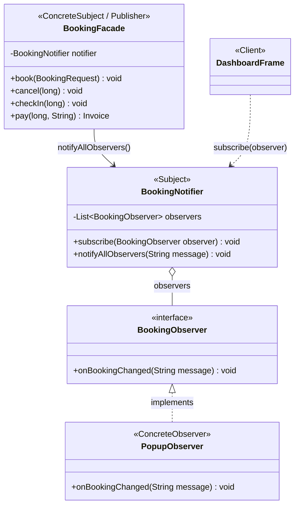

**(3) Sequence Diagram (Hình 3.16) & vai trò các lớp:**

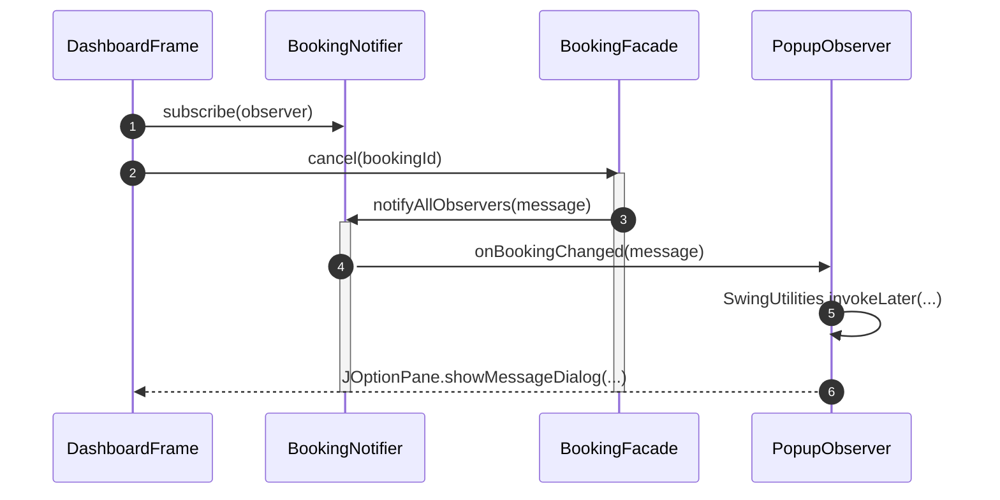

| Lớp | Vai trò (GoF) | Trách nhiệm trong hệ thống |
|-----|---------------|----------------------------|
| `BookingObserver` | **Observer** | Interface một phương thức `onBookingChanged(String)`. |
| `BookingNotifier` | **Subject** | Quản lý danh sách observer; phát thông điệp tới tất cả. |
| `BookingFacade` | **ConcreteSubject** | Sau mỗi thao tác nghiệp vụ gọi `notifyAllObservers(...)`. |
| `PopupObserver` (lambda trong `DashboardFrame`) | **ConcreteObserver** | Nhận thông điệp, đẩy lên luồng giao diện và hiện `JOptionPane`. |
| `DashboardFrame` | **Client** | Đăng ký observer lúc khởi tạo (`subscribe`). |

> **Quan hệ:** `BookingNotifier` **chứa (aggregation `o-->`)** nhiều `BookingObserver`; các observer **hiện thực** interface và có thể được thay thế/thêm mới mà không sửa `BookingNotifier` hay `BookingFacade`.

**(4) Ánh xạ mã nguồn:**

```java
public class BookingNotifier {
    private final List<BookingObserver> observers = new ArrayList<>();
    public void subscribe(BookingObserver observer) { observers.add(observer); }
    public void notifyAllObservers(String message) {
        observers.forEach(o -> o.onBookingChanged(message));
    }
}
```

**(5) Ưu/nhược:** tách rời "nguồn sự kiện" và "người nhận"; dễ thêm nhiều observer (ghi log, gửi email...). Nhược: cần quản lý đăng ký/hủy đăng ký cẩn thận để tránh rò rỉ bộ nhớ.

**(6) SOLID:** minh họa **OCP** (thêm observer không sửa `BookingNotifier`), **ISP** (interface `BookingObserver` tối giản) và **DIP** (phụ thuộc interface).

## 3.4. Tổng hợp & đối chiếu

**Bảng 3.1 — Tổng hợp các mẫu thiết kế áp dụng**

| # | Mẫu | Nhóm | Lớp chính | Nguyên lý SOLID minh họa |
|---|-----|------|-----------|--------------------------|
| 1 | Singleton | Creational | `DatabaseConnection` | SRP, DIP |
| 2 | Factory Method | Creational | `PaymentFactory` | OCP, DIP |
| 3 | Builder | Creational | `BookingRequest.Builder` | SRP |
| 4 | Facade | Structural | `BookingFacade` | SRP, DIP |
| 5 | Adapter | Structural | `BankPaymentAdapter`, `LegacyBankGateway` | OCP, LSP, DIP |
| 6 | Decorator | Structural | `PromoPricing`, `PromoCatalog` | OCP, LSP, DIP, SRP |
| 7 | Strategy | Behavioral | `PricingStrategy`, `StandardPricing`, `WeekendPricing`, `SeasonPricing`, `PricingSelector` | OCP, LSP, SRP |
| 8 | Observer | Behavioral | `BookingNotifier`, `BookingObserver` | OCP, ISP, DIP |

> Như vậy hệ thống áp dụng **8 mẫu thiết kế**, đạt **≥ 2 mẫu mỗi nhóm**: Creational = 3 (Singleton, Factory Method, Builder), Structural = 3 (Facade, Adapter, Decorator), Behavioral = 2 (Strategy, Observer) — đáp ứng yêu cầu đề tài.

**Bảng 3.2 — Danh mục sơ đồ trong Chương 3**

| Hình | Loại sơ đồ | Mẫu thiết kế |
|------|------------|--------------|
| 3.1 / 3.2 | Class / Sequence | Singleton |
| 3.3 / 3.4 | Class / Sequence | Factory Method |
| 3.5 / 3.6 | Class / Sequence | Builder |
| 3.7 / 3.8 | Class / Sequence | Facade |
| 3.9 / 3.10 | Class / Sequence | Adapter |
| 3.11 / 3.12 | Class / Sequence | Decorator |
| 3.13 / 3.14 | Class / Sequence | Strategy |
| 3.15 / 3.16 | Class / Sequence | Observer |

## 3.5. So sánh ưu, nhược điểm so với thiết kế thông thường

### 3.5.1. Khái niệm "thiết kế thông thường"

Trong phần này, **"thiết kế thông thường"** (conventional / procedural design) được hiểu là cách lập trình **tuyến tính, ít trừu tượng** — thường gặp ở các đồ án sinh viên hoặc phần mềm nhỏ:

- **Tầng giao diện chứa cả logic nghiệp vụ và SQL**: nút bấm gọi trực tiếp `DriverManager.getConnection()`, viết `SELECT/INSERT` ngay trong sự kiện của `JFrame`.
- **Một lớp "God class"** ôm toàn bộ nghiệp vụ, phình to hàng nghìn dòng.
- **Rẽ nhánh bằng `if/else`/`switch`** dài để xử lý mọi biến thể (phương thức thanh toán, chính sách giá, loại thông báo).
- **Không có interface trừu tượng**, mọi thứ phụ thuộc lớp cụ thể.
- **Không có tầng dữ liệu riêng**, câu lệnh SQL nằm rải rác khắp nơi.

Hệ thống trong đồ án được xây dựng theo hướng ngược lại (phân tầng + Design Patterns + SOLID), nên mục này đối chiếu trực tiếp hai cách tiếp cận.

### 3.5.2. So sánh theo từng khía cạnh chức năng

| Khía cạnh | Thiết kế thông thường | Thiết kế trong đồ án (có Pattern) | Mẫu/ Nguyên lý áp dụng |
|-----------|-----------------------|-----------------------------------|------------------------|
| **Kết nối CSDL** | Mỗi chỗ cần dữ liệu tự đọc cấu hình và mở `Connection` mới → trùng lặp, khó đổi môi trường | Một điểm cấu hình duy nhất, dùng chung | **Singleton** (`DatabaseConnection`) |
| **Tạo đối tượng thanh toán** | `if (method.equals("CASH")) ... else if ("CARD") ...` viết lặp lại ở nhiều nơi | Tập trung một điểm, trả về interface `Payment` | **Factory Method** (`PaymentFactory`) |
| **Dựng yêu cầu đặt phòng** | Constructor nhiều tham số hoặc setter rời rạc, dễ truyền sai thứ tự, không kiểm tra hợp lệ | Builder dựng từng bước, kiểm tra hợp lệ tập trung | **Builder** (`BookingRequest.Builder`) |
| **Chuỗi nghiệp vụ đặt phòng** | UI gọi lần lượt nhiều lớp/DAO, tự quản lý thứ tự gọi, dễ bỏ sót bước | Một cửa vào duy nhất `BookingFacade.book()` | **Facade** |
| **Tích hợp cổng ngân hàng cũ** | Sửa trực tiếp lớp cũ hoặc copy-paste mã của thư viện | Bọc lại bằng Adapter, giữ nguyên lớp cũ | **Adapter** (`BankPaymentAdapter`) |
| **Tính giá theo chính sách** | Chuỗi `if (isWeekend) ...` nhồi trong DAO, sửa DAO mỗi lần thêm chính sách | Mỗi chính sách một lớp, chọn tại runtime | **Strategy** (`PricingSelector`, `SeasonPricing`) |
| **Áp mã giảm giá / khuyến mãi** | Sửa thẳng công thức tính giá, `if (code == "SUMMER10") ...` rải rác | Bọc thêm một lớp giảm giá quanh chính sách gốc | **Decorator** (`PromoPricing`) |
| **Thông báo khi đơn đổi trạng thái** | Gọi cứng `JOptionPane.showMessageDialog(...)` ngay trong lớp nghiệp vụ → nghiệp vụ phụ thuộc Swing | Phát sự kiện cho observer, nghiệp vụ không biết UI | **Observer** (`BookingNotifier`) |
| **Truy cập dữ liệu** | SQL rải rác, khó test, khó thay CSDL | Tách `*Repository` (abstraction) khỏi `*DAO` | **DIP** |

### 3.5.3. Ví dụ minh họa "trước – sau"

**(a) Tạo đối tượng thanh toán**

*Thiết kế thông thường — rẽ nhánh lặp lại:*

```java
// Rải rác trong nhiều màn hình, mỗi nơi tự viết lại
Payment p;
if (method.equals("CASH"))       p = new CashPayment();
else if (method.equals("CARD"))  p = new CardPayment();
else                             p = new BankPaymentAdapter(new LegacyBankGateway());
```

*Thiết kế có Pattern — một điểm duy nhất:*

```java
Payment p = PaymentFactory.create(method); // client không biết lớp cụ thể
```

**(b) Tính giá**

*Thiết kế thông thường — logic trộn trong DAO:*

```java
// BookingDAO.create(...)
BigDecimal total = BigDecimal.ZERO;
for (LocalDate d = in; d.isBefore(out); d = d.plusDays(1)) {
    BigDecimal f = (d.getDayOfWeek() == DayOfWeek.SATURDAY
                 || d.getDayOfWeek() == DayOfWeek.SUNDAY) ? new BigDecimal("1.10") : BigDecimal.ONE;
    total = total.add(price.multiply(f));
}
// Muốn thêm giá lễ => sửa chính DAO này (vi phạm OCP)
```

*Thiết kế có Pattern — DAO không biết chính sách:*

```java
// BookingFacade chọn Strategy, DAO chỉ nhận và gọi
PricingStrategy pricing = PricingSelector.of(request.checkIn(), request.checkOut());
bookingDAO.create(request, pricing);   // thêm chính sách mới không sửa DAO
```

**(c) Thông báo**

*Thiết kế thông thường — nghiệp vụ gắn chặt với giao diện:*

```java
// Trong lớp nghiệp vụ
JOptionPane.showMessageDialog(null, "Đã hủy đơn #" + id); // phụ thuộc Swing!
```

*Thiết kế có Pattern — nghiệp vụ chỉ phát sự kiện:*

```java
notifier.notifyAllObservers("Đã hủy đặt phòng #" + id); // UI tự đăng ký lắng nghe
```

### 3.5.4. So sánh theo tiêu chí chất lượng phần mềm

| Tiêu chí | Thiết kế thông thường | Thiết kế có Pattern | Xu hướng |
|----------|-----------------------|---------------------|----------|
| **Dễ bảo trì** | Sửa một chỗ ảnh hưởng nhiều nơi (mã trùng lặp) | Thay đổi khu trú trong một lớp | ✔ Tốt hơn |
| **Dễ mở rộng** | Phải sửa nhiều `if/else`/lớp cũ | Chủ yếu thêm lớp mới (OCP) | ✔ Tốt hơn |
| **Khả năng kiểm thử** | Khó test vì UI, DB đan xen | Tách interface, có thể mock/tách tầng | ✔ Tốt hơn |
| **Tái sử dụng** | Mã bị sao chép giữa các màn hình | Dùng lại qua abstraction | ✔ Tốt hơn |
| **Dễ đọc – hiểu** | Luồng đơn giản, dễ đọc khi ít chức năng | Nhiều lớp/interface hơn, cần nắm kiến trúc | ▸ Trung tính/ Kém hơn ở dự án rất nhỏ |
| **Chi phí thiết kế ban đầu** | Thấp, viết nhanh | Cao hơn (thêm lớp, phân tầng) | ✘ Nhược điểm |
| **Số lượng lớp/ tệp** | Ít | Nhiều hơn | ✘ Nhược điểm |
| **Độ phức tạp khi debug** | Ít lớp nhưng luồng dài | Có thể phải lần theo nhiều lớp | ✘ Nhược điểm |
| **Khả năng mở rộng quy mô (mạng, đa cổng thanh toán)** | Rất khó, dễ vỡ | Thuận lợi, đúng chỗ để ghép thêm mẫu | ✔ Tốt hơn |

### 3.5.5. Tổng hợp đánh đổi (trade-off)

**Ưu điểm của thiết kế có Pattern:**
1. **Tách trách nhiệm** rõ ràng giữa giao diện – nghiệp vụ – dữ liệu.
2. **Mở rộng không phá vỡ** mã cũ (thêm cổng thanh toán, chính sách giá).
3. **Giảm trùng lặp** mã (tạo đối tượng, kết nối CSDL, thông báo).
4. **Dễ kiểm thử và bảo trì** nhờ abstraction.
5. **Chuẩn hóa giao tiếp** giữa các thành phần (Facade, Observer).

**Nhược điểm cần chấp nhận:**
1. **Nhiều lớp/tệp hơn** → tăng chi phí đọc – hiểu ban đầu.
2. **Trừu tượng hóa sớm** có thể là "over-engineering" nếu yêu cầu quá đơn giản.
3. **Chi phí thiết kế ban đầu cao hơn**.
4. Với dự án nhỏ, lợi ích chưa rõ ngay, cần thời gian mới thấy giá trị.

> **Kết luận:** Với một hệ thống có **quy trình nghiệp vụ nhiều bước**, **nhiều biến thể** (phương thức thanh toán, chính sách giá) và **có khả năng mở rộng**, thiết kế dùng Pattern **vượt trội** về bảo trì – mở rộng – kiểm thử. Cái giá phải trả là **độ phức tạp cấu trúc ban đầu**, điều này được biện minh bởi chính yêu cầu học phần (áp dụng tối thiểu 2 mẫu mỗi nhóm và tuân thủ SOLID).

## 3.6. Đánh giá mức độ tuân thủ SOLID

### 3.6.1. Bảng đánh giá tổng hợp

> Thang đánh giá: **✔ Đạt** (đáp ứng đầy đủ), **◐ Đạt phần lớn** (có bằng chứng rõ nhưng còn điểm hạn chế).

| Nguyên lý | Mức độ | Bằng chứng trong mã nguồn | Hạn chế còn lại |
|-----------|--------|---------------------------|-----------------|
| **SRP** – Đơn trách nhiệm | ✔ Đạt | `AuthService` chỉ xác thực (không chứa SQL); `*DAO` chỉ truy cập dữ liệu; `PricingSelector`/`PricingStrategy` tách khỏi DAO; `AppTheme` chỉ định nghĩa giao diện | `BookingDAO.transition()` vẫn ôm logic đồng bộ trạng thái phòng — có thể tách thành service |
| **OCP** – Mở/Đóng | ✔ Đạt | Thêm phương thức thanh toán: tạo lớp `Payment` mới + một nhánh trong `PaymentFactory`; thêm chính sách giá: tạo lớp `PricingStrategy` mới | `PaymentFactory` vẫn phải sửa khi thêm phương thức (dùng registry sẽ "đóng" hoàn toàn) |
| **LSP** – Thay thế Liskov | ✔ Đạt | `CashPayment`, `CardPayment`, `BankPaymentAdapter` dùng thay thế `Payment`; `StandardPricing`/`WeekendPricing` thay thế `PricingStrategy`; mọi observer thay thế `BookingObserver` | Không có tiền điều kiện/hậu điều kiện tường minh (Java không hỗ trợ `Design by Contract` sẵn) |
| **ISP** – Phân tách giao diện | ✔ Đạt | Các interface nhỏ: `Payment` (1 phương thức `pay`), `BookingObserver` (1 phương thức), mỗi `*Repository` chỉ khai báo thao tác tầng trên thực sự dùng | `RoomRepository` gom cả phòng lẫn loại phòng — có thể tách `RoomTypeRepository` |
| **DIP** – Đảo ngược phụ thuộc | ◐ Đạt phần lớn | `BookingService`/`BookingFacade`/`AuthService`/`PaymentService`/`RoomService`/`CustomerService` đều phụ thuộc `*Repository` (interface) thay vì `*DAO` | Việc khởi tạo cụ thể (`new BookingDAO()`) còn nằm ở tầng UI/`DashboardFrame`; lý tưởng là có DI container/injector |

### 3.6.2. Phân tích chi tiết từng nguyên lý

**(1) SRP — Single Responsibility Principle**

Mỗi lớp chỉ có **một lý do để thay đổi**:
- `AuthService`: chỉ lo xác thực đăng nhập. Trước khi refactor, lớp này còn viết SQL đăng nhập → giờ đã chuyển sang `UserDAO`/`UserRepository`.
- `BookingDAO`: chỉ truy cập bảng `bookings`/`booking_details`. Trước đây nó còn tự gọi `PricingSelector` để chọn giá → nay **chọn giá do `BookingFacade` đảm nhiệm**, DAO chỉ nhận `PricingStrategy` và tính tiền.
- `SqlErrors`: chỉ có một việc — dịch lỗi CSDL sang thông điệp tiếng Việt.
- Nhóm `ui.components` (`NavButton`, `StatCard`, `StatusCellRenderer`): mỗi lớp một vai trò hiển thị riêng.

**(2) OCP — Open/Closed Principle**

Mở rộng mà **không sửa mã đang chạy**:
- Thêm phương thức thanh toán "ví điện tử": tạo `EWalletPayment implements Payment`, thêm một nhánh ở `PaymentFactory` — **không** đụng tới `PaymentService`.
- Thêm chính sách giá "ngày lễ": tạo `HolidayPricing implements PricingStrategy`, cập nhật `PricingSelector` — **không** sửa `BookingDAO`/`BookingFacade`.
- Thêm kênh thông báo (ghi log, gửi email): tạo lớp `implements BookingObserver` rồi `subscribe` — **không** sửa `BookingNotifier`.

**(3) LSP — Liskov Substitution Principle**

Mọi lớp con/hiện thực có thể **thay thế** kiểu cha mà không phá vỡ hành vi:
- Bất kỳ đối tượng `Payment` nào cũng gọi được `pay(amount)` và trả về mô tả giao dịch.
- Bất kỳ `PricingStrategy` nào cũng gọi được `calculate(base, in, out)` trả về `BigDecimal ≥ 0`.
- `BankPaymentAdapter` tuân thủ hợp đồng `Payment` dù bên trong gọi `LegacyBankGateway.transfer(...)` khác tên/ kiểu.

**(4) ISP — Interface Segregation Principle**

Client **không bị ép phụ thuộc** phương thức không dùng:
- `Payment` chỉ có `pay(...)`; `BookingObserver` chỉ có `onBookingChanged(...)`.
- Các `*Repository` tách theo miền (Booking/Customer/Room/Payment/Invoice/User) thay vì một "DAO khổng lồ".

**(5) DIP — Dependency Inversion Principle**

Các module cấp cao (Service/Facade) **không phụ thuộc** module cấp thấp (DAO), cả hai phụ thuộc **abstraction**:

```java
// Trước (phụ thuộc cụ thể): BookingService biết BookingDAO
private final BookingDAO dao = new BookingDAO();

// Sau (phụ thuộc trừu tượng): chỉ biết interface
private final BookingRepository bookingDAO;
public BookingService(BookingRepository bookingDAO) { this.bookingDAO = bookingDAO; }
```

> **Hạn chế:** việc "lắp ráp" (wire) hiện thực cụ thể (`new BookingDAO()`) vẫn diễn ra ở tầng UI (`DashboardFrame`). Đây là "composition root" — chấp nhận được, nhưng nếu muốn hoàn thiện DIP ở mức cao hơn có thể áp dụng một **DI Container** hoặc Factory cho việc khởi tạo này.

### 3.6.3. Ma trận ánh xạ tương quan Mẫu ↔ Nguyên lý

Bảng dưới đây cho thấy mỗi mẫu thiết kế **tương quan với những nguyên lý SOLID nào** và tương quan đó *trực tiếp* hay chỉ là *hệ quả gián tiếp*.

> **Quy ước:** **✔** = tương quan trực tiếp (mẫu là phương tiện điển hình để hiện thực nguyên lý); **◐** = tương quan gián tiếp (đạt được như hệ quả phụ, không phải mục tiêu chính của mẫu); **—** = không có tương quan đáng kể.

| Mẫu thiết kế (lớp chính) | SRP | OCP | LSP | ISP | DIP | Tương quan nổi bật |
|--------------------------|:---:|:---:|:---:|:---:|:---:|--------------------|
| Singleton — `DatabaseConnection` | ✔ | — | — | — | ✔ | Một điểm truy cập kết nối duy nhất; tầng DAO chỉ phụ thuộc điểm này thay vì tự mở kết nối (DIP) |
| Factory Method — `PaymentFactory` | ✔ | ✔ | ✔ | — | ✔ | Tách khởi tạo `Payment` khỏi nơi sử dụng; thêm phương thức = thêm lớp + một nhánh, không sửa `PaymentService` (OCP) |
| Builder — `BookingRequest.Builder` | ✔ | — | — | — | — | Tách trách nhiệm "lắp ghép tham số đặt phòng" khỏi thực thể `BookingRequest` (SRP) |
| Facade — `BookingFacade` | ✔ | — | — | — | ✔ | Gói quy trình đặt phòng nhiều bước sau một API; Service chỉ phụ thuộc `BookingRepository` (DIP) |
| Adapter — `BankPaymentAdapter` | — | ✔ | ✔ | — | ✔ | Chuyển `LegacyBankGateway` về hợp đồng `Payment` (LSP) mà **không sửa** cả hai phía (OCP) |
| Decorator — `PromoPricing` | ✔ | ✔ | ✔ | — | ✔ | Bọc `PricingStrategy` để cộng thêm giảm giá; mở rộng hành vi mà không sửa lớp gốc (OCP) |
| Strategy — `PricingStrategy` | ✔ | ✔ | ✔ | — | ✔ | Hoán đổi thuật toán tính giá; thêm chính sách mới = thêm lớp (OCP) |
| Observer — `BookingNotifier` | — | ✔ | ✔ | ✔ | ✔ | Interface thông báo tối giản một phương thức (ISP); thêm kênh thông báo = thêm observer (OCP) |

**Đọc ma trận theo cột** (mức độ phủ của từng nguyên lý qua các mẫu):

| Nguyên lý | Số mẫu minh họa | Các mẫu tiêu biểu |
|-----------|:---:|-------------------|
| **SRP** | 6/8 | Singleton, Factory Method, Builder, Facade, Decorator, Strategy |
| **OCP** | 5/8 | Factory Method, Adapter, Decorator, Strategy, Observer |
| **LSP** | 5/8 | Factory Method, Adapter, Decorator, Strategy, Observer |
| **ISP** | 1/8 | Observer — *(ngoài ra ISP còn đạt ở tầng kiến trúc: các `*Repository` nhỏ, interface `Payment` một phương thức)* |
| **DIP** | 7/8 | Singleton, Factory Method, Facade, Adapter, Decorator, Strategy, Observer |

> **Liên hệ với Bảng 3.1 (§3.4):** Bảng 3.1 liệt kê nguyên lý **chủ đạo** mà mỗi mẫu minh họa; ma trận này mở rộng thành **tương quan đầy đủ** — cho thấy một mẫu có thể đồng thời phục vụ nhiều nguyên lý. Ví dụ `Decorator` và `Strategy` đều đóng góp cho cả bốn nguyên lý SRP, OCP, LSP, DIP; riêng **ISP** chủ yếu đến từ thiết kế interface nhỏ ở tầng kiến trúc hơn là từ một mẫu cụ thể.

### 3.6.4. Kết luận về mức độ tuân thủ

Hệ thống **tuân thủ đầy đủ 4/5 nguyên lý (SRP, OCP, LSP, ISP)** và **đạt phần lớn nguyên lý DIP** (giới hạn ở khâu lắp ráp cụ thể tại tầng UI). Kiến trúc phân tầng kết hợp Design Patterns cho phép thêm tính năng mới chủ yếu bằng **mở rộng** (thêm lớp) thay vì **sửa đổi** mã hiện hữu, giảm thiểu rủi ro hồi quy và nâng cao khả năng bảo trì — đúng tinh thần SOLID.

---

<a id="chương-4"></a>
# CHƯƠNG 4 — CÀI ĐẶT, THỬ NGHIỆM VÀ ĐÁNH GIÁ KẾT QUẢ

## 4.1. Môi trường & công nghệ

| Thành phần | Công nghệ |
|------------|-----------|
| Ngôn ngữ | Java 17 |
| Giao diện | Java Swing + Look and Feel FlatLaf 3.5.4 |
| Truy cập dữ liệu | JDBC |
| CSDL | MySQL 8 (`mysql-connector-j` 8.4.0) |
| Bảo mật mật khẩu | BCrypt (`jbcrypt` 0.4) |
| Quản lý build | Maven |

## 4.2. Cấu trúc mã nguồn

Mã nguồn được tổ chức theo **kiến trúc phân tầng**, mỗi tầng là một package riêng biệt. Các mẫu thiết kế được gom vào package `patterns` theo từng nhóm con.

```text
HotelManagement/
├── pom.xml                                   # Cấu hình Maven & dependencies
├── README.md                                 # Hướng dẫn cài đặt & chạy
├── database/
│   └── hotel_management.sql                  # Script tạo CSDL + dữ liệu mẫu
└── src/main/java/com/hotel/
    ├── Main.java                             # Điểm khởi chạy (main), install theme + mở LoginFrame
    │
    ├── config/                               # [Tầng hạ tầng]
    │   └── DatabaseConnection.java           # Singleton: quản lý kết nối MySQL
    │
    ├── model/                                # [Tầng Model] – record bất biến
    │   ├── Booking.java
    │   ├── Customer.java
    │   ├── Invoice.java
    │   ├── Room.java
    │   └── RoomType.java
    │
    ├── repository/                           # [Tầng Abstraction – hợp đồng truy cập dữ liệu]
    │   ├── BookingRepository.java            # Interface (abstraction – DIP)
    │   ├── CustomerRepository.java           # Interface
    │   ├── InvoiceRepository.java            # Interface
    │   ├── PaymentRepository.java            # Interface
    │   ├── RoomRepository.java               # Interface
    │   └── UserRepository.java               # Interface (+ record Account)
    │
    ├── dao/                                  # [Tầng Data Access – hiện thực JDBC]
    │   ├── BookingDAO.java                   # Hiện thực JDBC + transaction
    │   ├── CustomerDAO.java                  # Hiện thực JDBC
    │   ├── InvoiceDAO.java                   # Hiện thực JDBC
    │   ├── PaymentDAO.java                   # Hiện thực JDBC
    │   ├── RoomDAO.java                      # Hiện thực JDBC
    │   ├── UserDAO.java                      # Hiện thực JDBC (đăng nhập)
    │   └── SqlErrors.java                    # Helper: dịch lỗi ràng buộc CSDL sang tiếng Việt
    │
    ├── service/                              # [Tầng Nghiệp vụ / Controller]
    │   ├── AuthService.java                  # Xác thực đăng nhập (BCrypt)
    │   ├── BookingService.java               # API nghiệp vụ đặt phòng cho UI
    │   ├── CustomerService.java              # Nghiệp vụ khách hàng + kiểm tra đầu vào
    │   ├── PaymentService.java               # Nghiệp vụ thanh toán, hóa đơn, doanh thu
    │   └── RoomService.java                  # Nghiệp vụ phòng & loại phòng
    │
    ├── patterns/                             # [Các mẫu thiết kế]
    │   ├── builder/                          # Nhóm Creational
    │   │   └── BookingRequest.java           #   Builder: dựng yêu cầu đặt phòng
    │   ├── factory/                          # Nhóm Creational
    │   │   ├── Payment.java                  #   Interface Payment
    │   │   ├── CashPayment.java              #   Hiện thực tiền mặt
    │   │   ├── CardPayment.java              #   Hiện thực thẻ
    │   │   └── PaymentFactory.java           #   Factory Method
    │   ├── adapter/                          # Nhóm Structural
    │   │   ├── LegacyBankGateway.java        #   API ngân hàng cũ (không sửa)
    │   │   └── BankPaymentAdapter.java       #   Adapter → interface Payment
    │   ├── facade/                           # Nhóm Structural
    │   │   └── BookingFacade.java            #   Facade: điều phối chuỗi nghiệp vụ đặt phòng
    │   ├── strategy/                         # Nhóm Behavioral
    │   │   ├── PricingStrategy.java          #   Interface chính sách giá
    │   │   ├── StandardPricing.java          #   Giá tiêu chuẩn
    │   │   ├── WeekendPricing.java           #   Giá cuối tuần (+10%)
    │   │   └── PricingSelector.java          #   Chọn Strategy theo khoảng ngày
    │   └── observer/                         # Nhóm Behavioral
    │       ├── BookingObserver.java          #   Interface quan sát
    │       └── BookingNotifier.java          #   Subject: phát thông báo cho observers
    │
    └── ui/                                   # [Tầng Giao diện – View]
        ├── LoginFrame.java                   # Màn hình đăng nhập
        ├── DashboardFrame.java               # Màn hình chính (5 tab: Tổng quan, Phòng, Khách hàng, Đặt phòng, Hóa đơn)
        ├── components/
        │   ├── NavButton.java                # Nút điều hướng sidebar
        │   ├── StatCard.java                 # Thẻ thống kê
        │   └── StatusCellRenderer.java       # Tô màu trạng thái trong bảng
        └── theme/
            └── AppTheme.java                 # Định nghĩa màu/font/component dùng chung (FlatLaf)
```

### Mô tả chức năng từng package

| Package | Vai trò | Ghi chú thiết kế |
|---------|---------|------------------|
| `config` | Cấu hình kết nối CSDL | Áp dụng **Singleton** (`DatabaseConnection`) |
| `model` | Mô hình dữ liệu bất biến (Java record) | Trong suốt giữa các tầng, không chứa logic CSDL |
| `repository` | Hợp đồng truy cập dữ liệu (abstraction) | Chỉ chứa **interface** `*Repository` → hiện thực hóa **DIP** |
| `dao` | Truy cập dữ liệu (hiện thực) | Hiện thực `*Repository` bằng JDBC; dùng `PreparedStatement`, transaction, `SqlErrors` |
| `service` | Nghiệp vụ, kiểm tra đầu vào | Chỉ phụ thuộc `*Repository` (**DIP**); mỗi lớp một trách nhiệm (**SRP**) |
| `patterns` | Hiện thực 6 mẫu thiết kế | Chia theo 3 nhóm Creational / Structural / Behavioral |
| `ui` | Giao diện Swing | Gọi Service/Facade, **không** truy vấn SQL trực tiếp; dùng chung `AppTheme` |

### Ánh xạ tầng ↔ kiến trúc

| Tầng kiến trúc | Package tương ứng |
|----------------|-------------------|
| View (MVC) | `ui`, `ui.components`, `ui.theme` |
| Controller / Nghiệp vụ | `service`, `patterns.facade` |
| Model / Data Access | `repository`, `dao`, `model`, `config` |

> **Nhận xét:** cấu trúc package phản ánh trực tiếp kiến trúc 3 tầng ở Mục 2.3. Luồng phụ thuộc một chiều `ui → service/facade → dao → config` đảm bảo tầng trên không biết chi tiết tầng dưới, giúp mã nguồn dễ đọc, dễ kiểm thử và dễ mở rộng.

## 4.3. Kịch bản kiểm thử (Test Cases)

**Bảng 4.1 — Kịch bản kiểm thử**

| Mã | Kịch bản | Dữ liệu vào | Kết quả mong đợi | Pattern liên quan |
|----|----------|-------------|------------------|-------------------|
| TC01 | Đăng nhập đúng | admin / password | Vào DashboardFrame, hiển thị vai trò ADMIN | (AuthService) |
| TC02 | Đăng nhập sai | admin / sai | Thông báo "Sai tài khoản hoặc mật khẩu" | — |
| TC03 | Đặt phòng hợp lệ | khách + phòng trống + ngày tương lai | Tạo đơn `CONFIRMED`, thông báo giá áp dụng | Builder, Strategy, Facade, Observer |
| TC04 | Đặt trùng lịch | cùng phòng, khoảng ngày giao nhau | "Phòng đã được đặt trong khoảng thời gian này" | Facade (transaction) |
| TC05 | Nhận phòng | đơn `CONFIRMED` | `CHECKED_IN`, phòng chuyển "Đang dùng" | — |
| TC06 | Trả phòng | đơn `CHECKED_IN` | `CHECKED_OUT`, phòng "Trống" | — |
| TC07 | Thanh toán tiền mặt | đơn chưa trả | Ghi `payments` + tạo `invoices` | Factory |
| TC08 | Thanh toán chuyển khoản | đơn chưa trả | Đi qua `BankPaymentAdapter` → `LegacyBankGateway` | Factory, Adapter |
| TC09 | Giá cuối tuần | đặt phòng có ngày Thứ 7/CN | Tổng tiền tăng 10% các đêm cuối tuần | Strategy |
| TC10 | Hủy đơn đã thanh toán | đơn có `payments` | Bị chặn: "Đơn đã có thanh toán…" | Facade |
| TC11 | Nhận phòng ngày quá khứ | ngày nhận < hôm nay | Bị chặn: "Ngày nhận phòng không được ở quá khứ" | Builder |
| TC12 | Trùng số điện thoại khách | `phone` đã tồn tại | "Số điện thoại này đã được dùng…" | (SqlErrors) |
| TC13 | Xem doanh thu | có hóa đơn | Hiển thị tổng doanh thu đã thu | — |

## 4.4. Kết quả demo

*(Chèn ảnh chụp màn hình:)*
- Hình 4.1 — Màn hình đăng nhập.
- Hình 4.2 — Tổng quan (thẻ thống kê phòng/khách/đặt phòng).
- Hình 4.3 — Danh sách phòng & quản lý loại phòng.
- Hình 4.4 — Tạo đặt phòng và thông báo giá áp dụng (Observer).
- Hình 4.5 — Hộp thoại thanh toán và hóa đơn.
- Hình 4.6 — Tab "Hóa đơn & doanh thu".

## 4.5. Đánh giá hiệu năng

- Các truy vấn danh sách (`findAll`) có `INDEX`/khóa chính nên phản hồi nhanh.
- Việc **chống trùng đặt phòng** dùng transaction với `SELECT ... FOR UPDATE` khóa dòng phòng, đảm bảo an toàn khi nhiều thao tác đồng thời.
- Tính giá dùng `BigDecimal` với `RoundingMode.HALF_UP`, tránh sai số số thực.

## 4.6. Đánh giá khả năng bảo trì

- **Tách rời tầng:** UI không truy vấn SQL trực tiếp; nghiệp vụ không biết lớp DAO cụ thể.
- **Mở rộng không sửa đổi (OCP):** thêm phương thức thanh toán chỉ cần thêm lớp `Payment` + một nhánh trong Factory; thêm chính sách giá chỉ cần thêm lớp `PricingStrategy`.
- **Thay thế (LSP):** các hiện thực dùng thay thế interface mà không ảnh hưởng client.

## 4.7. Khó khăn & hạn chế

- Cổng thanh toán thật chưa tích hợp (`LegacyBankGateway` là mô phỏng).
- Mỗi đặt phòng hiện xử lý một phòng (`booking_details` đã hỗ trợ nhiều phòng nhưng UI chưa mở rộng).
- Chưa có cơ chế phân quyền chi tiết theo từng chức năng con.

---

<a id="chương-5"></a>
# CHƯƠNG 5 — KẾT LUẬN VÀ HƯỚNG PHÁT TRIỂN

## 5.1. Kết quả đạt được

1. Xây dựng thành công ứng dụng quản lý đặt phòng khách sạn chạy ổn định trên Java 17 + Swing + MySQL.
2. Áp dụng **7 mẫu thiết kế** thuộc **đủ 3 nhóm** (Creational, Structural, Behavioral), vượt yêu cầu tối thiểu 2 mẫu/nhóm.
3. Tuân thủ **5 nguyên lý SOLID**, thể hiện rõ qua kiến trúc phân tầng và việc dùng abstraction `*Repository`.
4. Hiện thực đầy đủ quy trình nghiệp vụ: đặt → nhận → trả → thanh toán/hóa đơn, kèm đồng bộ trạng thái phòng và ràng buộc nghiệp vụ.

## 5.2. Tự đánh giá theo tiêu chí

- **Bố cục & Hình thức:** trình bày theo chương/mục rõ ràng, có danh mục hình/bảng, trích dẫn nguồn.
- **Nội dung:** có phân tích bài toán, cơ sở lý thuyết, UML cho từng pattern, so sánh ưu/nhược, đánh giá SOLID và bộ kiểm thử.

## 5.3. Hướng phát triển

- Tích hợp **cổng thanh toán trực tuyến** thật (VNPay, Momo) qua Adapter.
- Mở rộng **đặt nhiều phòng/nhiều khách** trong một booking.
- Bổ sung **báo cáo thống kê** theo thời gian, xuất **PDF hóa đơn**.
- Thêm **Abstract Factory** cho nhóm phương thức thanh toán, **Decorator** cho dịch vụ cộng thêm (ăn sáng, spa).

---

<a id="tài-liệu-tham-khảo"></a>
# TÀI LIỆU THAM KHẢO

*(Trình bày theo chuẩn IEEE)*

[1] E. Gamma, R. Helm, R. Johnson, and J. Vlissides, *Design Patterns: Elements of Reusable Object-Oriented Software*. Boston, MA, USA: Addison-Wesley, 1994.

[2] R. C. Martin, *Clean Architecture: A Craftsman's Guide to Software Structure and Design*. Upper Saddle River, NJ, USA: Prentice Hall, 2017.

[3] R. C. Martin, "The Principles of OOD (SOLID)," *But Uncle Bob*, 2015. [Online]. Available: http://butunclebob.com

[4] Oracle, "Java Platform, Standard Edition 17 API Specification," Oracle Corp., 2021. [Online]. Available: https://docs.oracle.com/en/java/javase/17/

[5] MySQL, "MySQL 8.0 Reference Manual," Oracle Corp., 2024. [Online]. Available: https://dev.mysql.com/doc/

[6] B. Provos and D. Mazières, "A Future-Adaptable Password Scheme," in *Proc. USENIX Annual Technical Conf.*, 1999, pp. 81–91. (Thuật toán bcrypt)

---

# PHỤ LỤC

- **Phụ lục A:** Mã nguồn tiêu biểu — `BookingFacade`, `PaymentFactory`, `PricingSelector`.
- **Phụ lục B:** Toàn bộ script `database/hotel_management.sql`.
- **Phụ lục C:** Bảng phân công nhiệm vụ chi tiết và tỷ lệ đóng góp % của từng thành viên (điền khi nộp).
